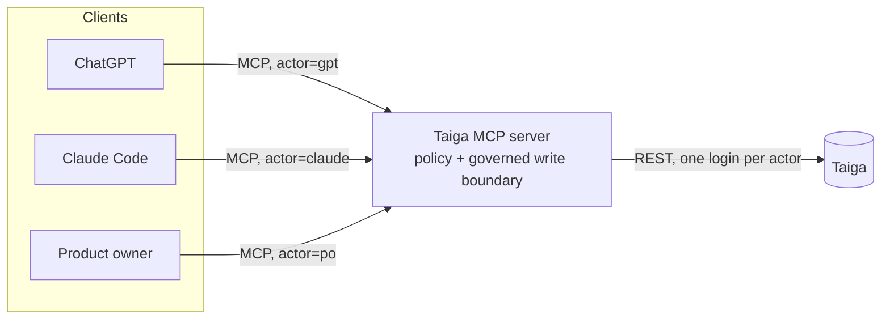

# Taiga MCP

**Governed project workflow for humans and AI agents, on top of [Taiga](https://taiga.io).**

Taiga MCP is a [Model Context Protocol](https://modelcontextprotocol.io/) server that lets AI agents (ChatGPT, Claude Code) and a human product owner work on the same Taiga project **without trampling each other**. Every agent gets its own authenticated identity, every state change goes through an explicit contract, and Taiga stays the single source of truth.

> **Status:** the governed workflow described under *What it does today* is in daily use. The configurable **policy engine** (per-project, versioned, with an admin UI) is designed and documented, and is the next milestone. See [Roadmap](#roadmap).

---

## Why

Handing an issue tracker to an AI agent is easy. Making that safe is not. In practice you need:

- **Clear ownership**: who executes a Task, who validates it, who may decide.
- **Closed transitions**: an agent cannot move a card "because it feels done".
- **Typed handoffs**: instructions, evidence and approvals are structured artifacts, not free chat.
- **Auditability**: every decision is traceable, and a merge can only happen after a verified approval.

Taiga MCP enforces these rules at the tool boundary, so the rules hold no matter which model is calling.

## What it does today

- **Full Taiga API coverage** as MCP tools (projects, epics, stories, tasks, issues, sprints, wiki, memberships, roles, custom attributes, and more).
- **Authenticated actors** (`gpt`, `claude`, `po`): one process, one Taiga login, one role. The actor is never self-declared by the model.
- **Executable workflow**: a strict state machine for Tasks and Stories. Transitions require a typed, validated artifact (Blueprint, Execution Handoff, Correction, Approval, ...) and are refused otherwise.
- **Single governed write path**: every workflow write follows one pipeline (fresh read, validators, declarative write, re-read, verify). A mismatch is reported, never silently retried.
- **Signed merge authorization**: when a Task is approved, an Ed25519 signature authorizes the Git merge, so a local tool such as a Git gate can refuse unapproved merges.
- **Stable identity**: work items carry a UUIDv7 generated by the server, so references survive renumbering.
- **Human Decision**: genuine product-owner choices pause the card until the owner moves it.
- **Safe errors**: upstream response bodies never reach an error message, so secrets cannot leak through failures.

## Architecture



- **Policy** (`src/workflow/policy.ts`): who may do what, evaluated before any write.
- **Governed write boundary** (`src/workflow/mutation.ts`): the only way workflow state changes.
- **Taiga is the only state.** The server keeps no cache that can disagree with it.

Details: [docs/reference/operations.md](docs/reference/operations.md) and the [transition matrix](docs/workflow/transition-matrix.md).

## Roadmap: the policy engine

The workflow rules are currently code. The next milestone turns them into **data**: a versioned, per-project policy with proposals, human approval, audited activation and rollback, backed by PostgreSQL, with a private admin API and an eight-screen console.

- Design: [docs/policy-engine/architecture.md](docs/policy-engine/architecture.md)
- Delivery plan: [docs/policy-engine/implementation.md](docs/policy-engine/implementation.md)
- Interactive UI preview (fictional data): [docs/policy-engine/ui/mockups.html](docs/policy-engine/ui/mockups.html)

Policies govern operations performed **through Taiga MCP**; they do not intercept direct writes to Taiga's own API or UI.

## Quick start

Requirements: Node.js 24+, a Taiga instance and a Taiga account per actor.

```bash
git clone <this-repository-url> taiga-mcp
cd taiga-mcp
npm ci
npm run build
cp .env.example .env      # fill in your own values; never commit .env
```

Register it in an MCP client (stdio), one server entry per actor:

```json
{
  "mcpServers": {
    "taiga": {
      "command": "node",
      "args": ["/absolute/path/to/taiga-mcp/dist/index.js"],
      "env": {
        "TAIGA_URL": "https://taiga.example.com",
        "TAIGA_USERNAME": "your-user",
        "TAIGA_PASSWORD": "your-password",
        "TAIGA_MCP_ACTOR": "claude"
      }
    }
  }
}
```

### Instructions for an AI agent

If you are an AI agent asked to install this project, follow exactly:

1. `git clone <this-repository-url> taiga-mcp && cd taiga-mcp`
2. `npm ci && npm run build`
3. Copy `.env.example` to `.env`. Ask the human for `TAIGA_URL` and the account credentials; never invent them and never print them back.
4. Run `node dist/index.js` once; it must wait on stdin without errors. Stop it.
5. Add the MCP entry shown above to the client configuration, with an absolute path and the correct `TAIGA_MCP_ACTOR`.
6. Report what you did without echoing any secret.

## Repository layout

```text
src/            server, tools and the workflow engine (src/workflow)
test/           node:test suites (no live Taiga needed)
workflow/       artifact templates
docs/           guides, reference, workflow matrix and policy-engine design
scripts/        helper scripts (key generation, guarded REST helper)
```

Real configuration, credentials and deployment seeds live in a **separate private repository** and are never part of this one.

## Development

```bash
npm run dev     # run from source
npm run build   # compile to dist/
```

CI runs on every push. Before anything is published, a public-surface check rejects private keys, tokens, `.env` files and internal addresses.

## Documentation

| Topic | Where |
|---|---|
| Getting started | [docs/getting-started.md](docs/getting-started.md) |
| Operations and governance reference | [docs/reference/operations.md](docs/reference/operations.md) |
| Workflow transition matrix | [docs/workflow/transition-matrix.md](docs/workflow/transition-matrix.md) |
| Policy engine (design and plan) | [docs/policy-engine/](docs/policy-engine/) |

## License

No license has been chosen yet. Until one is added, all rights are reserved.
