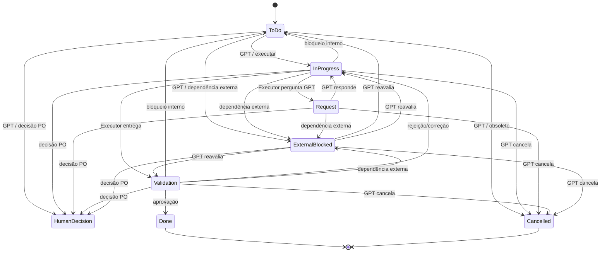
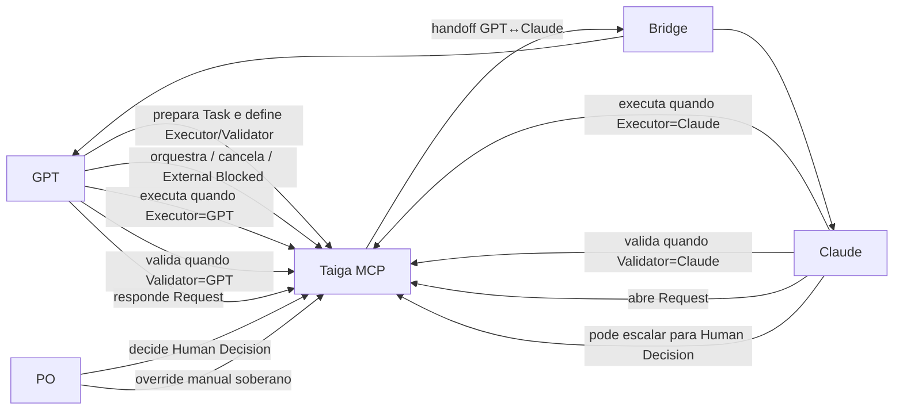
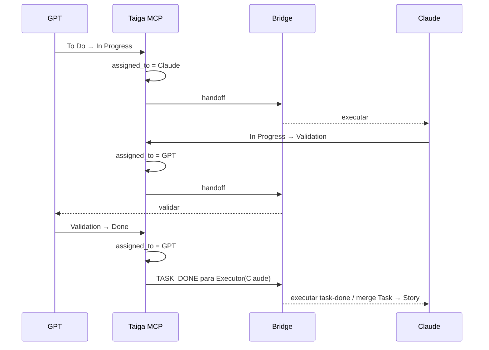
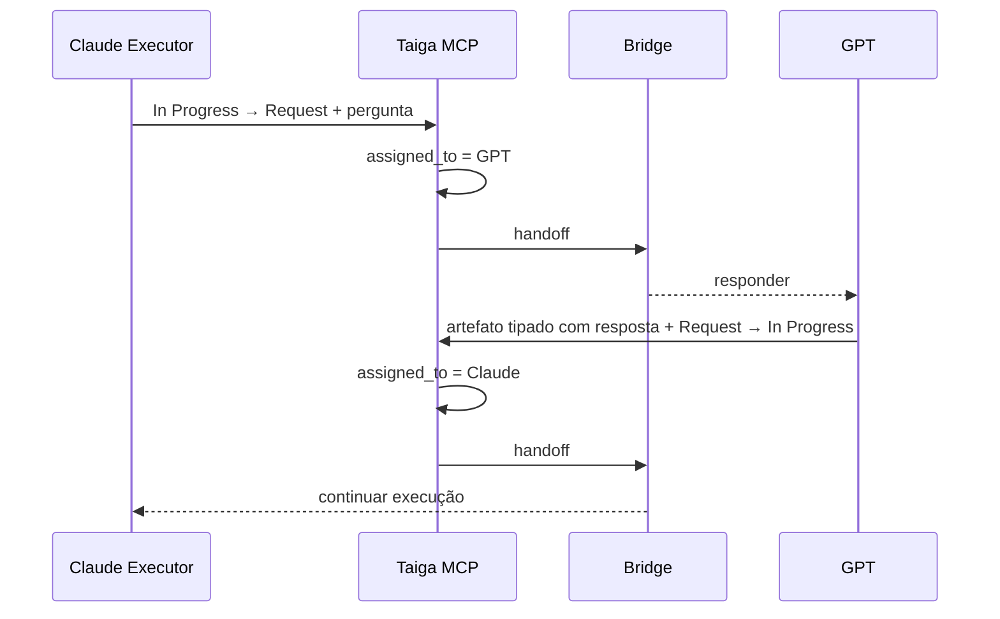
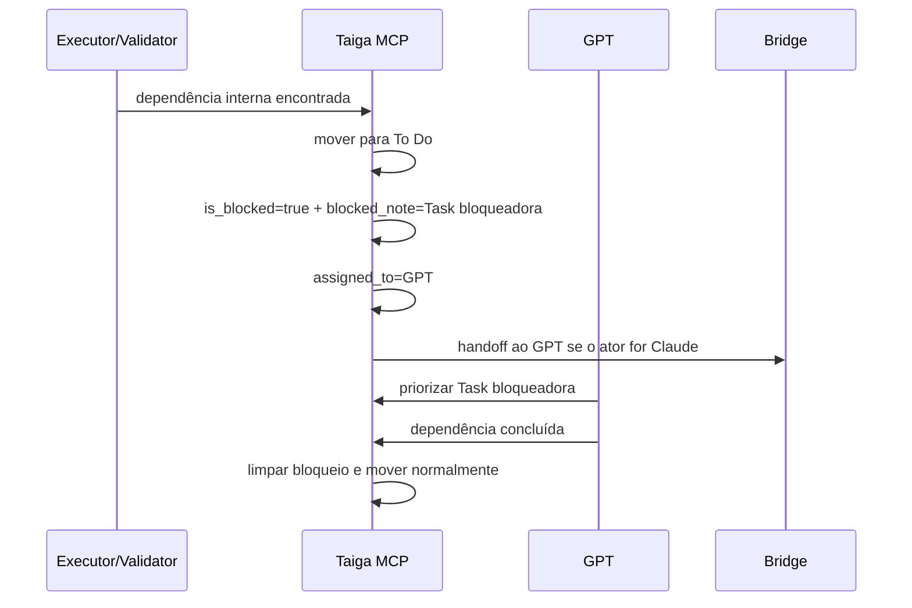
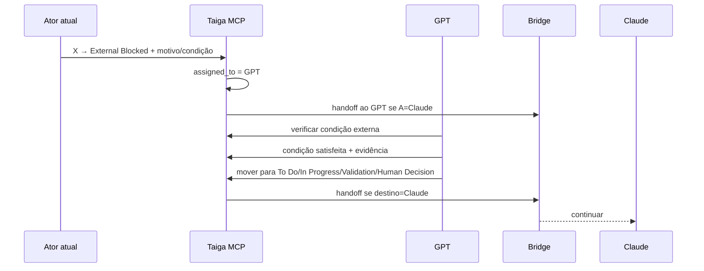
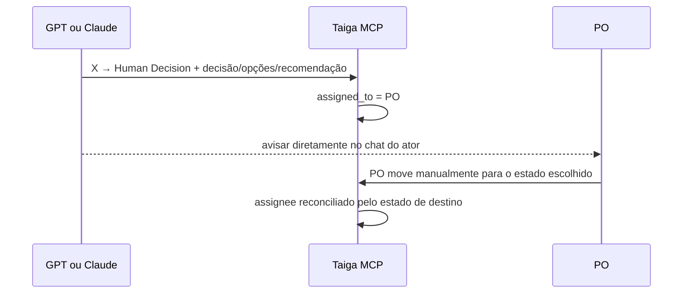

# Taiga MCP — Workflow Exhaustive Transition Matrix

## Status

**DRAFT CONTRACT — fonte de verdade para implementação e auditoria.**

## Instrução obrigatória para a revisão final do Claude

Esta revisão **é uma auditoria adversarial de verdade**, não uma nova rodada de design.

O Claude deve tentar quebrar o fluxo e procurar ativamente qualquer problema que possa causar falha operacional real, incluindo:
- contradição interna entre regras, matriz, assignment, notificações ou diagramas;
- transição impossível, dead-end, loop indevido ou estado sem saída útil;
- possibilidade de pular Validation, concluir errado, cancelar errado ou gerar merge indevido;
- situação em que ninguém sabe quem deve agir;
- handoff que não chega ao ator correto;
- movimento manual do PO que deixe o card incoerente;
- uso incorreto de Request, Human Decision, Internal Blocked ou External Blocked;
- ausência de regra sem a qual a implementação fique ambígua ou não determinística;
- conflito com o lifecycle Git/Story/Sprint já existente;
- qualquer caso concreto em que a implementação simples abaixo vá dar merda.

**Pode e deve levantar problema novo se ele for real.**

Mas **não reabrir discussão** por:
- preferência de texto;
- nomenclatura equivalente sem efeito operacional;
- detalhe cosmético de diagrama;
- sugestão de melhoria futura;
- alternativa “mais elegante” quando a regra atual já funciona;
- campo, estado, contador, prazo, chave, submáquina ou mecanismo adicional que não seja estritamente necessário;
- hipótese abstrata sem cenário concreto de falha.

Para cada problema levantado, o Claude deve mostrar:
1. cenário concreto;
2. regra/linha afetada;
3. o que quebra;
4. correção mínima necessária.

Se não houver problema operacional real, a resposta esperada é exatamente:

> **De acordo. Aprovado para implementação.**

Não criar nova lista de melhorias opcionais depois disso.

Escopo: workflow governado de **Tasks**. A matriz abaixo cobre todas as 64 combinações possíveis entre os 8 estados.

Princípio central: **nenhum estado necessário para operar o workflow fica escondido na memória do MCP**.

---

# 1. Estados oficiais

1. `To Do`
2. `In Progress`
3. `Request`
4. `Validation`
5. `External Blocked`
6. `Human Decision`
7. `Done`
8. `Cancelled`

---

# 2. Ownership por estado

A Task possui somente dois Custom Fields obrigatórios:

- `Executor`: GPT | Claude
- `Validator`: GPT | Claude

O profile do projeto define quem assume cada estado:

| Estado | Assignee normal |
|---|---|
| To Do | GPT |
| In Progress | `Executor` |
| Request | GPT |
| Validation | `Validator` |
| External Blocked | GPT |
| Human Decision | PO |
| Done | GPT |
| Cancelled | GPT |

Ao mudar de estado, o assignee é derivado desta tabela. O caller não escolhe assignee no fluxo automatizado.

O PO é soberano na UI do Taiga: pode mover ou editar qualquer card manualmente a qualquer momento. O MCP não tenta proibir isso. Quando o MCP observar o novo estado, aplica-se o assignee normal do estado de destino. Em **qualquer transição**, se o destino exigir `Executor` ou `Validator` e o campo correspondente estiver vazio, o assignee é GPT.

---

# 3. Regras simples de persistência

## Request

- Só **abre** a partir de `In Progress`.
- É uma pergunta do Executor para GPT.
- Pergunta e resposta ficam em **artefato tipado** no próprio Taiga; comentário livre de Task não é usado.
- Não existe Request ID, contador ou submáquina.
- Respondido → volta para `In Progress` e para o Executor.
- Se GPT é o Executor, não existe auto-Request para GPT; ele resolve a dúvida na própria execução ou usa `Human Decision` quando houver decisão real do PO.

## Internal Blocked

Não existe coluna `Blocked` para dependência interna do mesmo projeto.

Quando uma Task depende de outra Task do mesmo projeto:

- volta para `To Do`;
- `is_blocked=true`;
- `blocked_note` referencia inequivocamente a Task bloqueadora;
- a Task que desbloqueia assume prioridade acima dela;
- quando a dependência termina, GPT reavalia, limpa o bloqueio e move a Task normalmente.

## External Blocked

Usado quando uma dependência **externa ao fluxo do projeto** impede continuidade: outro projeto, serviço, infraestrutura, operador, vendor etc.

No Taiga fica apenas o necessário, em **artefato tipado**:
- o que bloqueia;
- motivo;
- condição objetiva de desbloqueio.

`External Blocked` é assigned ao GPT. Quando a dependência externa termina, GPT verifica a condição, registra a evidência, limpa o bloqueio e move a Task para o estado correto.

**Não existem `resume_status`, `resume_assignee` nem variável interna de retorno.**

## Human Decision

- `assigned_to = PO`.
- O **artefato tipado** contém decisão requerida, opções/evidência e recomendação do ator quando houver.
- Quem moveu para `Human Decision` avisa o PO diretamente no seu próprio chat.
- Bridge **não é usado para conversar com o PO**.
- O PO decide e move manualmente o card para onde quiser.
- Não existe variável interna de retorno.

---

# 4. Regras invariantes

1. Task nasce em `To Do`, assigned ao GPT.
2. Antes de iniciar execução, `Executor` e `Validator` devem estar preenchidos.
3. `In Progress` = persona Executor.
4. `Validation` = persona Validator.
5. Validator só inspeciona, testa, aprova, rejeita ou escala. Não implementa correção em `Validation`.
6. Toda execução normal passa por `Validation` antes de `Done`.
7. GPT pode ser Executor e Validator da mesma Task em fases diferentes; a separação é de persona/fase. `Executor=Claude` ⇒ `Validator=GPT`. `Executor=GPT` ⇒ `Validator=GPT` ou `Claude`. `Claude/Claude` é inválido e bloqueia `To Do → In Progress`.
8. `Request` só abre de `In Progress` e só faz sentido quando Executor != GPT.
9. Bloqueio interno usa `To Do + is_blocked/blocked_note`.
10. `External Blocked` é somente para dependência externa ao fluxo do projeto.
11. A decisão em `Human Decision` é exclusiva do PO; GPT, Executor e Validator podem mover a Task para esse estado conforme a matriz. Claude pode mover diretamente para `Human Decision` quando estiver atuando como Executor ou Validator.
12. GPT pode cancelar uma Task governada quando concluir que ela não faz mais sentido, registrando o motivo.
13. `Done` e `Cancelled` são terminais para o fluxo automatizado.
14. PO pode fazer qualquer movimento manual; isso é soberania do PO, não parte da autorização automática.
15. Bridge só transporta handoff GPT ↔ Claude.
16. `Validation → Done` emite `TASK_DONE` para o Executor, necessário ao fluxo Git/Story. O assignee de `Done` é sempre GPT.
17. Ordem/prioridade e a regra vigente de um item governado por vez dentro do projeto continuam valendo.
18. Story e Sprint têm lifecycle próprio; esta matriz não redefine lifecycle de Story/Sprint.
19. Task `Cancelled` não gera merge Git e conta como encerrada para o lifecycle da Story. Se houver branch GitGate ativa, ela precisa ser encerrada sem merge; o mecanismo definitivo é `task-abandon`, mas sua ausência **não bloqueia a implementação do Taiga MCP**. Até existir, pode haver bypass operacional controlado no GitGate. Se o PO mover uma Task com branch ativa para `Done`, o Executor encerra a branch com `task-done` quando houver trabalho a integrar.

---

# 5. Matriz completa — 64 combinações

**Como ler:** `Auto?` descreve o fluxo governado normal. O PO pode fazer override manual de qualquer linha pela UI; isso não transforma a transição em parte do fluxo automatizado. Após movimento manual do PO, se o assignee normal do destino for Claude, o handoff normal via Bridge é emitido quando o MCP observar/reconciliar a mudança.

| Origem | Destino | Auto? | Quem pode mover automaticamente | Assignee destino | Notificação | Condição / regra |
|---|---|---:|---|---|---|---|
| To Do | To Do | Não | — | GPT | Não | Sem transição |
| To Do | In Progress | Sim | GPT | Executor | Bridge se Executor=Claude | Executor+Validator preenchidos; Task não bloqueada |
| To Do | Request | Não | — | GPT | Não | Request só abre de In Progress |
| To Do | Validation | Não | — | Validator | Não | Não há execução para validar |
| To Do | External Blocked | Sim | GPT | GPT | Não | Dependência externa comprovada |
| To Do | Human Decision | Sim | GPT | PO | GPT avisa PO no chat | Decisão do PO necessária antes de executar |
| To Do | Done | Não | — | GPT | Não | Validation não pode ser pulada |
| To Do | Cancelled | Sim | GPT | GPT | Não | Motivo registrado |
| In Progress | To Do | Condicional | Executor ou GPT | GPT | Bridge se ator=Claude | Somente bloqueio interno: set is_blocked + blocked_note |
| In Progress | In Progress | Não | — | Executor | Não | Sem transição |
| In Progress | Request | Condicional | Executor | GPT | Bridge se Executor=Claude | Só se Executor != GPT; pergunta registrada |
| In Progress | Validation | Sim | Executor | Validator | Bridge se identidade mudar | Execução terminou; handoff registrado |
| In Progress | External Blocked | Sim | Executor ou GPT | GPT | Bridge se ator=Claude | Dependência externa comprovada |
| In Progress | Human Decision | Sim | Executor ou GPT | PO | Ator avisa PO no próprio chat | Decisão do PO necessária |
| In Progress | Done | Não | — | GPT | Não | Validation obrigatória |
| In Progress | Cancelled | Sim | GPT | GPT | Bridge para Claude se o assignee atual for Claude | Motivo registrado |
| Request | To Do | Não | — | GPT | Não | Request não vira backlog |
| Request | In Progress | Sim | GPT | Executor | Bridge se Executor=Claude | Resposta registrada |
| Request | Request | Não | — | GPT | Não | Não existe Request aninhado |
| Request | Validation | Não | — | Validator | Não | Request não é Validation |
| Request | External Blocked | Sim | GPT | GPT | Não | A resposta depende de fator externo; ao resolver, volta para `In Progress`; o Executor reabre Request se ainda precisar |
| Request | Human Decision | Sim | GPT | PO | GPT avisa PO no chat | Pergunta revelou decisão de PO |
| Request | Done | Não | — | GPT | Não | Request não conclui Task |
| Request | Cancelled | Sim | GPT | GPT | Não | Motivo registrado |
| Validation | To Do | Condicional | Validator ou GPT | GPT | Bridge se Validator=Claude | Somente bloqueio interno: set is_blocked + blocked_note |
| Validation | In Progress | Sim | Validator | Executor | Bridge se identidade mudar | Validação rejeitou; correção volta ao Executor |
| Validation | Request | Não | — | GPT | Não | Dúvida do Validator vira rejeição `Validation → In Progress`, registrada no artefato tipado de correção |
| Validation | Validation | Não | — | Validator | Não | Sem transição |
| Validation | External Blocked | Sim | Validator ou GPT | GPT | Bridge se Validator=Claude | Validação depende de fator externo |
| Validation | Human Decision | Sim | Validator ou GPT | PO | Ator avisa PO no próprio chat | Validação exige decisão do PO |
| Validation | Done | Sim | Validator | GPT | TASK_DONE ao Executor (Bridge se Executor=Claude); handoff ao GPT se Validator=Claude | Aprovação de Validation |
| Validation | Cancelled | Sim | GPT | GPT | Bridge para Claude se o assignee atual for Claude | Motivo registrado |
| External Blocked | To Do | Condicional | GPT | GPT | Não | Dependência resolvida; deve voltar à fila/bloqueio interno |
| External Blocked | In Progress | Condicional | GPT | Executor | Bridge se Executor=Claude | Dependência resolvida; execução pode continuar |
| External Blocked | Request | Não | — | GPT | Não | Request só abre de In Progress |
| External Blocked | Validation | Condicional | GPT | Validator | Bridge se Validator=Claude | Dependência resolvida; validação pode continuar |
| External Blocked | External Blocked | Não | — | GPT | Não | Atualiza o artefato tipado, não o estado |
| External Blocked | Human Decision | Sim | GPT | PO | GPT avisa PO no chat | Dependência externa virou decisão de PO |
| External Blocked | Done | Não | — | GPT | Não | Done exige Validation |
| External Blocked | Cancelled | Sim | GPT | GPT | Não | Motivo registrado |
| Human Decision | To Do | Não automático | — | GPT | Handoff via Bridge se assignee destino=Claude | PO pode mover manualmente |
| Human Decision | In Progress | Não automático | — | Executor | Handoff via Bridge se assignee destino=Claude | PO pode mover manualmente |
| Human Decision | Request | Não automático | — | GPT | Handoff via Bridge se assignee destino=Claude | PO pode mover manualmente |
| Human Decision | Validation | Não automático | — | Validator | Handoff via Bridge se assignee destino=Claude | PO pode mover manualmente |
| Human Decision | External Blocked | Não automático | — | GPT | Handoff via Bridge se assignee destino=Claude | PO pode mover manualmente |
| Human Decision | Human Decision | Não | — | PO | Não | Sem transição |
| Human Decision | Done | Não automático | — | GPT | Handoff via Bridge se assignee destino=Claude | PO pode mover manualmente; override explícito |
| Human Decision | Cancelled | Não automático | — | GPT | Handoff via Bridge se assignee destino=Claude | PO pode mover manualmente |
| Done | To Do | Não automático | — | GPT | Handoff via Bridge se assignee destino=Claude | Somente override manual do PO |
| Done | In Progress | Não automático | — | Executor | Handoff via Bridge se assignee destino=Claude | Somente override manual do PO |
| Done | Request | Não automático | — | GPT | Handoff via Bridge se assignee destino=Claude | Somente override manual do PO |
| Done | Validation | Não automático | — | Validator | Handoff via Bridge se assignee destino=Claude | Somente override manual do PO |
| Done | External Blocked | Não automático | — | GPT | Handoff via Bridge se assignee destino=Claude | Somente override manual do PO |
| Done | Human Decision | Não automático | — | PO | Handoff via Bridge se assignee destino=Claude | Somente override manual do PO |
| Done | Done | Não | — | GPT | Não | Sem transição |
| Done | Cancelled | Não automático | — | GPT | Handoff via Bridge se assignee destino=Claude | Somente override manual do PO |
| Cancelled | To Do | Não automático | — | GPT | Handoff via Bridge se assignee destino=Claude | Somente override manual do PO |
| Cancelled | In Progress | Não automático | — | Executor | Handoff via Bridge se assignee destino=Claude | Somente override manual do PO |
| Cancelled | Request | Não automático | — | GPT | Handoff via Bridge se assignee destino=Claude | Somente override manual do PO |
| Cancelled | Validation | Não automático | — | Validator | Handoff via Bridge se assignee destino=Claude | Somente override manual do PO |
| Cancelled | External Blocked | Não automático | — | GPT | Handoff via Bridge se assignee destino=Claude | Somente override manual do PO |
| Cancelled | Human Decision | Não automático | — | PO | Handoff via Bridge se assignee destino=Claude | Somente override manual do PO |
| Cancelled | Done | Não automático | — | GPT | Handoff via Bridge se assignee destino=Claude | Somente override manual do PO |
| Cancelled | Cancelled | Não | — | GPT | Não | Sem transição |

---

# 6. Project profile e migração

O canonical SCOPE project profile deve ser a fonte da configuração, não código espalhado.

Status canônicos de Task:
- To Do
- In Progress
- Request
- Validation
- External Blocked
- Human Decision
- Done
- Cancelled

Mudanças obrigatórias:
1. Renomear `GPT Validation` para `Validation`.
2. Adicionar `External Blocked`.
3. Garantir Custom Fields `Executor` e `Validator`.
4. Incorporar ownership por estado.
5. Novos projetos já nascem neste profile.
6. Projetos existentes passam por dry-run de `taiga_project_apply_profile` e depois aplicação governada.
7. `taiga_uuid_initialize_project` continua aplicando o mesmo canonical profile e UUIDv7; não existe segundo profile.
8. `GPT Validation → Validation` é rename canônico, não status paralelo.
9. Templates, RULES.md, WORKFLOW.md, RUNBOOK, CLAUDE.md, mensagens Bridge e código MCP que citam `GPT Validation` ou o fluxo antigo de Human Decision são atualizados no mesmo release.
10. Antes de aplicar o profile em projeto existente, GPT preenche `Executor` e `Validator` de todas as Tasks abertas (fora de `Done`/`Cancelled`).
11. No profile, `Done` e `Cancelled` têm `is_closed=true`; os outros seis estados de Task têm `is_closed=false`.
12. Dependência de execução localizada: `task-abandon` é necessário **somente antes do primeiro caso real** de cancelamento de Task com branch GitGate ativa. Isso **não bloqueia a Sprint do Taiga MCP**. Se esse caso aparecer antes de `task-abandon` existir, usar bypass operacional controlado no GitGate, registrar a exceção e voltar imediatamente ao Taiga MCP; a implementação definitiva do GitGate pode ser coordenada depois.

---

# 7. Bridge / notificações

1. Bridge é somente transporte GPT ↔ Claude.
2. Não conversa com PO.
3. Mudança GPT → Claude: notifica Claude.
4. Mudança Claude → GPT: notifica GPT.
5. GPT → GPT e Claude → Claude: silêncio.
6. `Validation → Done` emite `TASK_DONE` para o Executor; se Executor=Claude, via Bridge.
7. Movimento manual do PO para `Done` não emite `TASK_DONE` nem dispara merge automaticamente.
8. Ao reconciliar movimento manual do PO, se o destino tiver Claude como assignee, o MCP emite handoff via Bridge.
9. Em `Human Decision`, quem moveu avisa o PO diretamente no próprio chat.

---

# 8. Diagramas canônicos

## 8.1 State Machine — fluxo automatizado

**PO override:** não aparece como arestas acima porque não faz parte do fluxo automatizado. O PO pode mover manualmente qualquer card para qualquer estado.

## 8.2 Use Cases operacionais

## 8.3 Claude executa; GPT valida

## 8.4 Request

## 8.5 Internal Blocked

## 8.6 External Blocked

## 8.7 Human Decision

---

# 9. Checklist adversarial

1. Sair de `To Do` para execução sem Executor/Validator.
2. Escolher assignee arbitrário no fluxo automatizado.
3. Executor fazer `In Progress → Done`.
4. Não-Validator fazer `Validation → Done`.
5. Validator implementar correção dentro de Validation.
6. Abrir Request a partir de estado diferente de In Progress.
7. Criar auto-Request com Executor=GPT.
8. Não-GPT responder Request.
9. Request resolvido não voltar para In Progress.
10. Dependência interna criar coluna/status Blocked.
11. Dependência interna não usar `is_blocked/blocked_note`.
12. External Blocked ser usado para Task do mesmo projeto.
13. External Blocked depender de `resume_status`, `resume_assignee` ou memória MCP.
14. Human Decision depender de variável de retorno.
15. Bridge tentar conversar com PO.
16. Não-PO decidir Human Decision.
17. GPT ficar impossibilitado de cancelar Task obsoleta.
18. Validation → Done não entregar TASK_DONE ao Executor.
19. Handoff GPT↔Claude não notificar o novo responsável.
20. Handoff para a mesma identidade produzir mensagem inútil.
21. PO manualmente mover card e o sistema tentar proibi-lo.
22. Estado observado após movimento do PO não reconciliar assignee pelo destino ou não emitir handoff para Claude quando Claude se torna assignee.
23. Profile ainda criar `GPT Validation`.
24. Profile não criar `External Blocked`.
25. Profile não garantir Executor/Validator.
26. Novo projeto nascer fora do canonical profile.
27. Projeto existente UUIDv7-ready continuar com profile antigo.
28. Matriz, código, testes, templates e docs divergirem.
29. Executor/Validator mover para `Human Decision` e não avisar o PO no próprio chat.
30. Task fora de `To Do` sem Executor/Validator ficar sem assignee após reconciliação.
31. Cancelar Task e gerar merge Git.
32. Cancelar Task com branch GitGate ativa e deixar a Task ativa, bloqueando `task-start`/`story-done`.
33. Migrar projeto com Task aberta sem preencher `Executor`/`Validator`.
34. Criar `Cancelled` com `is_closed=false`.

---

# 10. Critério de aprovação

O contrato está aprovado quando:
- as 64 combinações têm comportamento explícito;
- não existe estado operacional oculto no MCP;
- somente Executor/Validator exigem Custom Fields;
- bloqueio interno usa mecanismos já existentes do Taiga;
- Request, External Blocked e Human Decision usam artefatos tipados existentes, sem comentário livre nem submáquina;
- Validation é incontornável no fluxo automatizado;
- GPT pode cancelar;
- PO continua soberano manualmente;
- Bridge fica restrito a GPT ↔ Claude;
- canonical project profile cria/migra todos os projetos para este vocabulário e garante `Done`/`Cancelled` fechados no Taiga;
- templates, RULES.md, WORKFLOW.md, RUNBOOK, CLAUDE.md e mensagens Bridge convergem no mesmo release;
- testes implementam a matriz sem acrescentar estados, contadores, prazos ou submáquinas.
