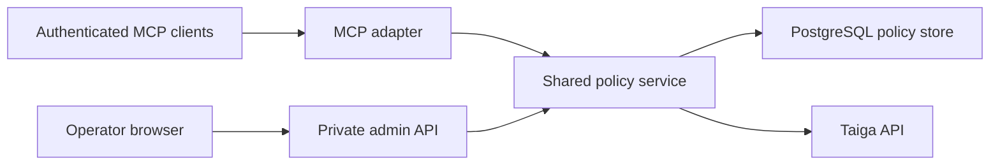

# Taiga MCP
**Project-scoped workflow governance for humans and AI agents.**

> Portfolio README draft for the planned policy-engine release. The implementation team must validate the commands and replace this status note only after the corresponding features are implemented and tested. Do not publish this draft as a completed product.

Taiga MCP connects the [Model Context Protocol](https://modelcontextprotocol.io/) (MCP) to [Taiga](https://taiga.io/), a project management platform. Its planned policy engine enables teams to configure how authenticated humans and AI agents collaborate, without embedding a different workflow in application code for each project.

## Why this project?
AI-assisted software development needs more than access to issue trackers. It needs clear responsibility for execution and validation, explicit permissions for state transitions, reliable handoffs, and an auditable record of decisions. Different projects may require different combinations of agents and human oversight. Taiga MCP is designed to enforce these rules at the tool boundary while retaining Taiga as the source of truth for project data.

## Design preview
[Explore the eight-screen interactive HTML design preview](ui/mockups.html).

The prototype uses fictional illustrative data and does not connect to a backend. Before public release, replace project-specific demo names with generic fixtures and confirm that the HTML link is served correctly; GitHub may display the source rather than run HTML. Add a screenshot of the implemented console using sanitized fixtures. Do not include private operational screenshots.

## Planned capabilities
- Versioned, project-scoped workflow policies using role-based access control (RBAC) with typed contextual guards.
- Separate ownership, transition permissions and operation permissions, with explicit deny decisions.
- A shared policy service for MCP tools and a private administrative HTTP API.
- An eight-screen console for projects, ownership, transitions, operations, proposals, history, overview and system health.
- Human-controlled approval, revision history and audited activation without restarting the service.
- PostgreSQL persistence, reconciliation of interrupted operations and explicit handling of uncertain external writes.
- Automated testing, reproducible builds, deployment evidence and controlled rollback.

## Architecture

The backend remains the sole policy authority. The browser handles presentation and requests; it does not decide permissions. Taiga retains project entities, status and operational history. The policy database stores governance metadata, revisions, audit records and reconciliation state. The system is deliberately a modular monolith rather than a collection of microservices.

**Enforcement boundary:** policies govern operations performed through Taiga MCP. They do not automatically intercept direct writes to Taiga's native API or UI. Operators must manage those access paths separately.

## Technology
TypeScript, Node.js, pnpm, PostgreSQL, Docker Compose, GitLab CI/CD, and a lightweight HTML/CSS/TypeScript administrative UI. The backend reuses the existing MCP transport. Development uses live reload; production serves built assets only.

## Getting started
Release preparation checklist (replace with tested copy-paste instructions before publication):
1. Clone the public repository and install the pinned Node.js and pnpm versions documented in the repository.
2. Install dependencies with `pnpm install --frozen-lockfile`.
3. Copy the shipped example configuration to an untracked local configuration file. Configure a disposable Taiga instance or test project, the PostgreSQL connection and the authenticated MCP/admin identities. Never commit real credentials.
4. Run the documented development Compose command; apply migrations using the repository's actual migration command.
5. Open the private admin address printed by the server. Connect an MCP client using the shipped configuration example.
6. Create a test project, inspect its default policy, propose a change, and approve it as an authorized operator. Confirm the next eligible operation uses the new revision.

The final README must include the exact tested commands, ports/config variables, supported versions, expected output, a minimal MCP client configuration using placeholders, and troubleshooting for DB readiness, authorization failures and drift. No installation command or port may be invented.

## API and workflow
The planned admin API is versioned under `/admin/api/v1`. The final release documents its actual endpoints and schemas, including project inventory, policy inspection, simulation, proposal review, activation and audit history. A proposal is not active until authorized approval succeeds. Existing MCP consumers should retain their supported contracts.

## Quality and delivery
The intended delivery pipeline validates source and contracts, exercises PostgreSQL integration and browser workflows, packages an immutable release, and publishes/deploys the verified revision. Deployment health checks identify the running build and commit. Tests distinguish legacy behavior parity from new policy functionality. Failures and partial external effects are surfaced rather than silently retried.

## Security and limitations
Use authenticated identities and least-privilege service accounts. Keep the administrative listener and database private. Policy checks take place on the backend. Do not publish real tokens, internal network details, deployment configuration, production data, or private research excerpts. External API operations are not a distributed transaction with PostgreSQL; uncertain results require reconciliation.

## Contributing and license
Before release, include contribution/test instructions, the actual license and required upstream attribution, and a security reporting channel. Do not claim a license that has not been verified. Document supported versions and known limitations honestly.

---
**Release note for the implementation team:** Remove all draft instructions from the public README after testing. Add actual screenshots, links to public architecture docs, commands, license, and release evidence. Use only repository paths verified to exist in the public tree. Private design/research package is not part of the public release.
