# TAIGA MCP — Policy Engine: arquitetura v1.0 (consolidada)
v1.0 · 24/11/2026 · consenso Claude+GPT em `debate-r5-claude.md`. Execução: **somente** `implementation.md` v1.0. Nada é executado sem autorização do PO.

Este documento descreve arquitetura, dados, API, UI, diagramas e inventário. Onde algo conflitar com `implementation.md` v1.0, **prevalece o implementation.md**.

## Correções normativas v1.0 (prevalecem sobre qualquer trecho abaixo)
1. **Topologia:** um processo HTTP residente (`/mcp` + admin privado no mesmo processo), um TaigaClient por ator, um Postgres em disco local (host-agnóstico via `DATABASE_URL`; Docker/Incus **não** são requisitos da arquitetura). Launchers stdio por ator são desligados no cutover.
2. **Versões:** v1 = legado (7 estados, 49 pares); v2 = matriz de 64 pares (owner por `executor`/`validator`, External Blocked, Human Decision simplificado), só por migração aprovada na UI, nunca default de projeto existente.
3. **Admin auth:** bearer PO em memória da página, sem cookie/CSRF próprio; GET também 401 sem token. Sessão server-side/cookie descritos abaixo estão **superados**.
4. **Journal:** uma linha por transição composta; evidência de recuperação, nunca autoridade (o Taiga manda).
5. **Fases:** a tabela histórica de fases (§7) e o diagrama "Fases e gates" estão **superados** por F0–F5 do implementation.md. Incus opcional foi removido.
6. **Assinatura de merge** centralizada no residente; reconcile M-4 por `version`; Done manual do PO nunca autoriza merge.


## Revisão integral v0.3 — decisões normativas (24/11/2026)
Esta revisão cruza os três arquivos do pacote, código/pipelines existentes, RAG global (sem collections, authors ou outros filtros nas consultas finais) e documentação pública oficial. implementation.md v0.3 é o runbook normativo; o HTML aprovado é a referência visual. Os diagramas e o SQL abaixo são modelos conceituais, subordinados às correções desta seção. Não executar antes da revisão Claude/PO. Nenhum código produtivo foi alterado.

| Área revisada | Parecer / correção | Aceite |
|---|---|---|
| C1–C4, limites, use cases | Manter monólito TypeScript, pg, listener admin privado, dois containers, um catálogo. C4 ilustra responsabilidades, não exige classes/arquivos. | Dependências apontam para domínio; sem segundo motor ou serviço. |
| ERD, SQL e dados | Integridade composta por projeto em parent, review, activation, previous, audit e journal; bootstrap intent antes de ID externo; append-only e índices de FKs. | PG real rejeita referências cruzadas e update/delete indevidos. |
| Máquina de estados e matrizes | Separar permissão, owner, guard e efeito. Gerar todas combinações a partir de catálogo real; diagonal não é automaticamente permitida; PO override não ignora invariantes. | Oráculo legado antes de refactor; teste de reachability e todas combinações. |
| Provisionamento, mirror, drift | Identidade instance+project ID; não usar slug; não reescrever UUID ou policy; pending não vira legacy por erro de DB. | Falha parcial, readback, rename, invisibilidade e reexecução. |
| Sequências e concorrência | Um lock cooperativo por projeto, intent durável antes do REST; transações curtas; nenhum retry cego após timeout. Aprovação exige expected revision e hash; não prometer atomicidade Taiga/PG. | Crash em cada fronteira e teste com duas conexões. |
| Bridge e Git | Destinatário explícito por efeito, preservar assinatura, não trocar destinatário histórico ao recuperar; nenhuma segunda fila/worker desnecessária. | GPT-only e baseline em projetos diferentes; restart e assinatura válidos. |
| Inventário MCP | Lista preliminar não é catálogo completo. Gerar inventário da registration runtime, cross-check contra handlers e mutadores internos; regra ausente bloqueia projeto gerenciado. | Cobertura bidirecional e zero external writes em deny. |
| UI/UX | Preservar exatamente HTML aprovado, dark, cores, SVG, oito páginas. Roles/bindings e funções extras dentro das páginas/abas existentes, não criar nova navegação. Dados e decisões somente via API. | Screenshots, teclado, foco, contraste, dados não confiáveis. |
| CI/CD, deploy e rollback | Antecipar CI na fase 0B; conservar tags; build imutável e release com todos gates; runner DEV separado; impedir deploy obsoleto. | Mesmo SHA/digest, health real, pipeline red/cancel não publica. |
| Publicação e README | README.md novo é modelo público em inglês, sem evidência privada; publicação via pipeline após revisão de histórico, licença e autorização. | README executável validado por checkout limpo; nenhum claim não testado. |

RAG adicional: Learning PostgreSQL p.253 (trace 1368, chunk 0c5cc486-3706-5f9f-a555-924919c28580) explica locks cooperativos; PostgreSQL Up and Running pp.199–200 (1367, c3a669a6-f4f0-5d49-8369-da9ea7558384 e 5b551a43-5d7b-54a4-ba23-3f9553540cda) sustenta FKs e índices; Geewax API Design Patterns, Request deduplication (1369, e887c4d0-80b2-56a6-8404-cf229acc624a), Versioning and compatibility (1363, 877e0cc8-a0a0-58e1-96f5-779527748f8b); Bass/Clements/Kazman, Documenting Behavior (1362, a2415414-90ca-5304-8cc0-c488250abdc7); Clements et al., Documenting Software Architectures pp.370/396 (1370, e0ca6473-5bf6-5139-8f94-3564c8f970ab, 9f9704dd-d43f-59d3-9915-12b9241ee35b); Newman e Zimmermann et al. autorização (1372, 8940201e-366b-5c54-964c-1bac5ad71fd6, b97e2b11-49b7-5fb5-a342-cea62138cbb3). As referências fundamentam decisões, não provam implementação. GitLab Cowell/Lotz/Timberlake não recuperado pela busca global até trace 1374; confirmado sumário público, não conteúdo integral.

Fontes externas efetivamente consultadas: https://www.postgresql.org/docs/current/explicit-locking.html ; https://www.postgresql.org/docs/current/ddl-constraints.html ; https://docs.gitlab.com/ci/yaml/ ; https://docs.gitlab.com/ci/environments/deployment_safety/ ; https://docs.gitlab.com/ci/jobs/ci_job_token/ ; https://docs.docker.com/compose/how-tos/startup-order ; https://cheatsheetseries.owasp.org/cheatsheets/Authorization_Cheat_Sheet.html ; https://modelcontextprotocol.io/specification/latest/basic/transports ; https://vite.dev/config/server-options ; https://playwright.dev/docs/test-snapshots ; https://www.w3.org/TR/wcag/ ; https://www.w3.org/WAI/ARIA/apg/patterns/accordion/ ; https://docs.github.com/en/repositories/managing-your-repositorys-settings-and-features/customizing-your-repository/about-readmes ; https://www.packtpub.com/en-us/product/automating-devops-with-gitlab-cicd-pipelines-9781803233000 . Validar versões efetivamente instaladas; documentação current não determina major a adotar.

## Referências visuais da UI
[Protótipo HTML navegável — oito telas](ui/mockups.html). Abrir localmente no navegador. Dados demonstrativos, sem backend. Referência de UX: RAG traces 1327, 1329 e 1330 (tabelas de dados, usabilidade e prevenção de erros, accordion e divulgação progressiva); manter edição separada da aprovação, estados explícitos e navegação por entidade. As capturas estáticas não foram copiadas ao workspace; o HTML é a referência visual disponível.

## Instrução autocontida ao Claude
Revisar a proposta contra o HEAD atual e o runtime efetivamente implantado. Usar Dev MCP/workspace e RAG para decisões; consultar o REACH para UI/implantação. Identificar cenários concretos de regressão, bypass, drift, race, perda de histórico, dead-end, falha de deploy e quebra Bridge/GitGate. Para cada achado: evidência, severidade, efeito, correção mínima e teste. Não implementar, não parar serviços, não criar branches ou cards sem aprovação. Não concordar ou discordar por obrigação. Preservar KISS/YAGNI e todos os requisitos MVP. Propor revisão do documento e encaminhar ao GPT. Quando resolvidos todos os bloqueios materiais, declarar aprovação para implementação sujeita à decisão PO.

## Estado de validação
Leitura estática de arquivos selecionados e API Taiga via MCP, consultas RAG com evidências substantivas e inventário das ferramentas expostas na sessão. Não foi executado código, teste, migração, renderização Mermaid, deploy ou modificação de projetos. SQL, API e arquivos novos são propostas, não implementação pronta. SHA do runtime, topologia efetiva do tunnel/Incus e catálogo exaustivo de side effects devem ser confirmados na fase 0. Preservar a matriz efetivamente implementada; DRAFT de 64 pares observado no repositório é distinto.

---

# TAIGA MCP — Policy Engine, PostgreSQL e Administração Web
**Proposta para Adversarial Design Review | 24/11/2026 | v0.1 | Não autorizada para execução**

## 0. Mandato e resultado esperado
Transformar o MCP atual em motor de governança orientado a dados, com políticas por projeto, todas as operações e transições explicitamente inventariadas, PostgreSQL dedicado (via DATABASE_URL), API e UI administrativas funcionais já no MVP. O Taiga continua sendo autoridade de projetos, entidades, status, ordenação, UUIDs e histórico operacional. O MCP é autoridade de política, aprovação, autorização e execução governada. Não replicar cartões nem construir outro Taiga. O PO configura/aprova via interface; agentes podem propor, não ativar. GPT-only é uma configuração, não um branch de código. Preservar passado e comportamento default atual. Nada hardcoded operacional (ADR-0007); invariantes de integridade são código, não flags desativáveis. Claude Code implementará após consenso; este documento não é autorização para mudanças, deploy ou parada.

## 1. Evidências e baseline (leitura estática)
Repositório observado: taiga-mcp/ no workspace SCOPE. Capturar SHA exato do repo efetivamente implantado na fase 0: esta revisão não prova identidade com binário em execução. Leitura de src/policy abaixo refere-se a src/workflow/policy.ts. 
- src/workflow/policy.ts:15-20 detecta perfil por vocabulário; 73-106 matrizes Task/Story/Epic; 117-138 autorização incluindo override PO; 141-148 ownership fixo; 165-175 read model. Request tem regras especiais. Epic canônico tem Proposed/Active/Blocked/Completed/Archived, portanto não satisfaz necessariamente CARD_NAMES strict: não inventar equivalência. Story e Epic admitem caminhos legacy; modelar explicitamente.
- src/governance.ts:17-65 switch global em arquivo; 88-113 bulk/status/ordenação; 115-155 Engineering Review e promoção; 158-201 comentários, descrição, closure; 203-242 wrapper apenas de parte das operações; 284-362 transition typed/legacy. Não confundir o catálogo atual com permissões já impostas; muitas mutações são autorizadas pela API Taiga e não pela matriz.
- src/workflow/transition.ts:90-230 autenticação, matriz, artefatos, links, requests, assinatura; 236-269 preconditions + comentário persistido antes de PATCH + readback; 277-312 merge, ordenação, promoção automática e anúncio.
- src/workflow/assignment.ts:14-51 owner/status -> membro ativo por conta configurada; criação e backfill; assigned_to é projeção, nunca autoridade.
- src/workflow/tools.ts: task state, requests create/answer, human decision; todas as regras e descrições precisam refletir a mesma política. src/workflow/start-rules.ts e engineering-review.ts mantêm precedência e uma tarefa ativa; story-readiness.ts promove quando filhos terminais; story-order.ts e move.ts mantêm ordem.
- src/workflow/notify.ts:26-37 notice por transição; continuation.ts:39,74-81 assume o outro agente; continuation-recovery.ts reconstrói destino fixo GPT/Claude; continuation-tools.ts e milestones.ts também anunciam. Sem alteração nesses pontos GPT-only não funciona corretamente.
- src/workflow/actor.ts:11-87 identidade fixa gpt/claude/po via ambiente ou bearer HTTP, assinatura de texto não autentica. account-binding.ts verifica contas. Identidade, role de projeto e persona de execução são conceitos distintos.
- src/identity.ts:44-160 protege UUIDv7 existente, detecta duplicidades, backfill e readback. UUID-ready exige quatro tipos: Epic, Story, Task, Issue. Sprint não tem atributo UUID. Projeto tampouco tem UUIDv7 canônico nativo demonstrado; usar ID Taiga + instância. src/project-profile.ts:9-51 perfil e defaults; 127-204 applyProfile/prepareProject. tools/projects.ts:50-72 criação default e preparação. tools/export-import.ts é caminho alternativo.
- src/server.ts:33-68 factory registra todos os módulos; src/http.ts:12-59 cria servidor MCP por POST, um TaigaClient compartilhado, valida Host/Origin; src/index.ts suporta entrypoint; Dockerfile Node 20/pnpm e docker-compose.yml hoje um serviço sem DB. package.json só SDK e Zod como dependências runtime. Não adicionar microserviços/frameworks sem necessidade.
- docs/Taiga MCP - Workflow Exhaustive Transition Matrix.md: DRAFT, 64 pares, Executor/Validator, Validation e External Blocked. NÃO é baseline executado: código observado usa GPT Validation e sete colunas Task no REACH, sem External Blocked. Não implementar esse DRAFT por acidente. Pode virar proposta futura após ADR explícita.
- REACH MCP projeto 58: roles GPT 342 e CLAUDE CODE 343 com as mesmas 31 permissões nativas; statuses To Do, In Progress, Request, GPT Validation, Human Decision, Done, Cancelled. RAG MCP 59 segue perfil. IDs apenas observações, proibido hardcode.
- Referência visual REACH: reach/reach-mcp/packages/server/src/admin-page.ts, admin.ts, http-server.ts, admin-ui/{shell,nav,theme,design,components,assets,api-client,api,projects,proposals,system,logs,overview,clients}.ts e reach-logo.png. Estudar padrões, não copiar identidade visual nem acoplar REACH.
- Testes existentes: workflow.test.ts, governance.test.ts, assignment.test.ts, initial-assignment.test.ts, account-binding.test.ts, identity.test.ts, project-profile.test.ts, start-rules.test.ts, story-order.test.ts, sprint-order.test.ts, engineering-review.test.ts, merge-auth.test.ts, milestone-close-notification.test.ts, issue-promote.test.ts, write-boundary.test.ts, http.test.ts, server-factory.test.ts, rest-closure.test.ts, task-order.test.ts, project-module-flags.test.ts. Rodar todos antes e depois. coverage-data e ops/rest-closure complementam catálogo.

### RAG consultado (referências verificáveis, sem atribuir conteúdo não recuperado)
- Eric Evans, Domain-Driven Design, seção Strategy (a.k.a. Policy): separar alternativas de comportamento do processo. Head First Design Patterns, seção Speaking of Design Patterns: Strategy, encapsular variação. Justifica PolicyResolver único e motor estável. Consulta anterior recuperou trechos substantivos.
- Patterns for API Design, Endpoint Roles, chunk b97e2b11-49b7-5fb5-a342-cea62138cbb3, trace 1316: pontos de decisão e enforcement (PDP/PEP), RBAC/ABAC. Building Microservices, Fine-Grained Authorization, chunk 8940201e-366b-5c54-964c-1bac5ad71fd6: autorização fina no recurso, não só gateway. Justifica autorização no MCP, não somente UI/tunnel.
- Consultas iniciais 1317–1319 recuperaram principalmente títulos/índices. Foram refeitas de forma focada: Michael Feathers, Working Effectively with Legacy Code, Characterization Tests, trace 1320, chunks 25324431-5a75-5721-826e-79476b0867b3, 31a057e7-e440-5b29-9ca4-d87f3096469d e b595096d-f29c-5b51-84e7-c92f0e1966e0: testes registram comportamento observado, incluindo comportamento suspeito, antes de mover funcionalidade. Fundamenta fase 1 e oráculo de paridade.
- Martin Kleppmann, Designing Data-Intensive Applications, Idempotence, trace 1321, chunk 047eb800-f33b-5b5a-94be-de08f0fe1622; Samuel Newman, Building Microservices, Idempotency, chunk 4b67f169-6273-565b-aa72-6792a00dd98e: metadata de operação permite detectar reaplicação; repetição cega de operação não idempotente gera efeitos duplicados. Fundamenta provisioning intent, journal, readback e reconciliação; não implica que Taiga suporte transação distribuída.
- Head First Design Patterns, The State Pattern defined, trace 1322, chunk b7acea3b-61b2-5d20-a0bb-a1c96a49d515: composição permite variar comportamento sem mudar a estrutura; fundamenta separar matriz de política da máquina de estados. Não introduzir uma classe por estado se funções e dados bastarem.
- RBAC (Role-Based Access Control) + condições de contexto tipadas (estado, projeto, ownership, vínculo, sprint, artefato), não implementar ABAC genérico, DSL, execução de código ou SQL configurável.

## 2. Arquitetura alvo e limites
Monólito modular TypeScript existente + driver pg, migrações SQL numeradas, UI estática integrada ao HTTP server e Postgres privado. Um repositório, uma imagem MCP, um processo residente (app) + um Postgres, tunnel existente apontando ao /mcp. Sem Redis, ORM pesado, Kafka, Kubernetes, motor de regras externo, microfrontend, segundo motor de workflow ou clone de cartões. PostgreSQL guarda documentos JSONB de política versionados e metadados relacionais; regras são dados declarativos validados. A avaliação é determinística e pura. Um catálogo versionado de operações + predicados implementados por funções; catálogo define o que é tecnicamente possível, política define quem pode e em quais condições. Não permitir que dados inventem endpoints, artefatos, códigos executáveis, bypass de UUID, autenticação ou assinatura.
- Taiga: status, entidade, UUID e artefatos históricos, versão otimista.
- DB MCP: binding de instância/projeto, snapshots de metadados (não cards), políticas imutáveis, ativações, propostas, auditoria de decisões e journal mínimo de mutações em andamento.
- PolicyResolver: uma versão ativa por projeto, verificada no início de cada operação; sem TTL de autorização no MVP. Simulação e execução usam mesma função. 
- PEP: interceptação central + resolução de escopo server-side; ferramentas internas que fazem efeitos compostos também checadas em fronteiras semânticas. Não confiar em nome de tool inferido por regex nem parâmetros de projeto fornecidos sem conferir entidade.
- PDP: (principal autenticado, role, recurso, operação, estado origem/destino, policy version, facts) -> allow/deny, regra, artefato requerido, owner, efeitos previstos. Default deny para regras ausentes em projeto gerenciado, operações novas e configurações inválidas. Legacy baseline contém permissões explícitas que reproduzem permissividade anterior; não chamar comportamento novo de paridade.
- Identidade: preservar tokens e contas atuais. Roles arbitrários configuráveis no catálogo, bindings a principal autenticado; nenhum role ganha autoridade apenas por nome no Taiga. MVP provisiona gpt/claude/po e bindings configuráveis; novos agentes requerem identidade real e adaptador compatível, não só editar célula. PO admin não delegável por política comum. System interno não é role selecionável por caller.
- UI e API admin compartilham PolicyService; nunca acesso direto do navegador ao Postgres. PO lê/edita/aprova; agentes autenticados propõem e simulam com escopo; permissões de leitura de políticas separadas de acesso a documentos/segredos.
- Preservar protocolo MCP e ferramentas existentes, parâmetros e envelopes de merge quando possível. Atualizar descrição das ferramentas para consultar ações disponíveis em vez de citar matriz fixa. Não quebrar Claude Bridge/GitGate.
- Limite: ações diretamente na API/UI original Taiga podem contornar PEP MCP. Não prometer enforcement universal. Operadores/PO mantêm acesso manual existente; agentes devem usar exclusivamente MCP, restringir credenciais e rede conforme operação. Detectar drift e registrar. Enforcement de UI nativa exigiria alteração Taiga ou proxy obrigatório: fora do MVP, não fingir que está resolvido.

## 3. Modelo de dados (SQL de referência, revisar com Claude)
Banco dedicado taiga_policy, não usar banco interno Taiga. PostgreSQL versão suportada e pinada de acordo com infraestrutura atual (preferência mesma major do REACH/RAG se aplicável; verificar). Driver pg e SQL migrator simples, advisory lock de migração, schema version.
```sql
CREATE TABLE taiga_instance (
  id uuid PRIMARY KEY, instance_key text NOT NULL UNIQUE,
  base_url text NOT NULL, created_at timestamptz NOT NULL DEFAULT now()
);
CREATE TABLE project_binding (
  id uuid PRIMARY KEY, instance_id uuid NOT NULL REFERENCES taiga_instance,
  taiga_project_id bigint NOT NULL, slug text NOT NULL, name text NOT NULL,
  lifecycle text NOT NULL CHECK(lifecycle IN
    ('pending','managed','drift','inaccessible','archived','legacy')),
  uuid_ready boolean NOT NULL DEFAULT false,
  profile_fingerprint text, metadata jsonb NOT NULL DEFAULT '{}',
  last_seen_at timestamptz, active_activation_id uuid,
  UNIQUE(instance_id,taiga_project_id)
);
CREATE TABLE policy_version (
  id uuid PRIMARY KEY, project_id uuid NOT NULL REFERENCES project_binding,
  revision bigint NOT NULL, parent_id uuid REFERENCES policy_version,
  catalog_version text NOT NULL, schema_version integer NOT NULL,
  payload jsonb NOT NULL, content_hash text NOT NULL,
  proposed_by text NOT NULL, created_at timestamptz NOT NULL DEFAULT now(),
  UNIQUE(project_id,revision), UNIQUE(project_id,id)
);
CREATE TABLE policy_review (
  id uuid PRIMARY KEY, project_id uuid NOT NULL REFERENCES project_binding,
  policy_id uuid NOT NULL, decision text NOT NULL CHECK(decision IN
    ('approved','rejected','withdrawn')), actor text NOT NULL,
  reason text NOT NULL, reviewed_at timestamptz NOT NULL DEFAULT now(),
  FOREIGN KEY(project_id,policy_id) REFERENCES policy_version(project_id,id)
);
CREATE TABLE policy_activation (
  id uuid PRIMARY KEY, project_id uuid NOT NULL REFERENCES project_binding,
  policy_id uuid NOT NULL, review_id uuid NOT NULL REFERENCES policy_review,
  previous_activation_id uuid REFERENCES policy_activation,
  activated_by text NOT NULL, reason text NOT NULL,
  activated_at timestamptz NOT NULL DEFAULT now(),
  UNIQUE(project_id,id),
  FOREIGN KEY(project_id,policy_id) REFERENCES policy_version(project_id,id)
);
ALTER TABLE project_binding ADD FOREIGN KEY(id,active_activation_id)
  REFERENCES policy_activation(project_id,id);
CREATE TABLE policy_audit (
  id uuid PRIMARY KEY, project_id uuid REFERENCES project_binding,
  activation_id uuid REFERENCES policy_activation, principal text NOT NULL,
  operation text NOT NULL, resource_kind text, resource_key text,
  decision text NOT NULL, rule_key text, correlation_id uuid NOT NULL,
  details jsonb NOT NULL DEFAULT '{}', occurred_at timestamptz NOT NULL DEFAULT now()
);
CREATE TABLE mutation_journal (
  id uuid PRIMARY KEY, project_id uuid NOT NULL REFERENCES project_binding,
  activation_id uuid NOT NULL REFERENCES policy_activation,
  operation text NOT NULL, target_key text, expected_taiga_version bigint,
  phase text NOT NULL, evidence_ref text, result jsonb,
  created_at timestamptz NOT NULL DEFAULT now(), updated_at timestamptz NOT NULL DEFAULT now()
);
```
Revisar constraints compostas adicionais: review pertence à mesma versão/projeto, parent/previous ao mesmo projeto, aprovação válida e hash exato; impor em transaction + FK/trigger quando necessário. project_binding é único dono do ponteiro ativo, não guardar flags active duplicadas. IDs do DB podem ser UUIDv7 gerados pelo app; não substituir IDs/UUIDs Taiga. Política e revisão são append-only; role DB runtime sem update/delete nessas tabelas, migrations role separado; auditoria sem conteúdo sensível. Índices por projeto, correlation, data, phase e version. JSON canonicalizado antes de SHA256; hash não substitui aprovação. Snapshot de metadata contém status IDs/names, roles, defaults, definições UUID, módulos, nunca tokens. Sem copiar cards. Export/import JSON de políticas, validação e diff antes de propor. Default template versionado em release, importado como versão inicial de cada projeto; copiar conteúdo imutável, alterações em template não afetam projetos antigos.

#### 3.0 Correções obrigatórias ao SQL ilustrativo antes da implementação
O journal mostrado acima exige project_id/activation_id e portanto NÃO serve diretamente para o intent de criação de projeto antes de existir o ID externo. Resolver sem inventar ID Taiga: adicionar tabela pequena provisioning_intent (id UUID, instance_id FK, principal, operation, request_key único por instância, request_hash, external_project_id nullable, phase, evidence, timestamps), ou generalizar mutation_journal com escopo bootstrap explícito e constraints condicionais. Preferência: tabela separada pela diferença de lifecycle. Registrar antes do POST, persistir ID quando conhecido; lock por request key; status incerto exige reconciliação, não replay cego. Não prometer exatamente-once para API externa sem suporte a idempotency key.
Também adicionar FK composta review/projeto/policy em activation, UNIQUE de review_id quando uma aprovação corresponder a uma ativação, parent e previous compostos, constraints de JSON schema e transações de publicação. Auditoria e journal do bootstrap têm referência de instância mesmo sem binding. O SQL é especificação inicial, não migration pronta. Retenção não apaga versões/ativações, e backups devem preservar relações. Adicionar no catálogo versão e resultado verificável da decisão; autorização da criação de projeto pertence à política global de bootstrap, não a projeto inexistente.

## 3.1 Formato de política
```json
{
 "schemaVersion":1,"catalogVersion":"1",
 "roles":["gpt","claude","po"],
 "bindings":{"gpt":{"principal":"gpt"},"claude":{"principal":"claude"},"po":{"principal":"po"}},
 "entities":{
   "task":{
     "initialStatus":"to do",
     "states":{
       "to do":{"owner":"gpt"},
       "in progress":{"owner":"claude"},
       "request":{"owner":"gpt"},
       "gpt validation":{"owner":"gpt"},
       "human decision":{"owner":"po"},
       "done":{"owner":null},"cancelled":{"owner":null}
     },
     "operations":{"create":{"allow":["gpt","claude","po"],"constraints":["legacy_create_contract"]}},
     "transitions":[
       {"from":"to do","to":"in progress","allow":["gpt","po"],"artifact":"implementation_blueprint","mode":"initial","guards":["task_start"],"effect":"execution_release"},
       {"from":"in progress","to":"gpt validation","allow":["claude"],"artifact":"execution_handoff","guards":["current_blueprint"],"effect":"execution_handoff"}
     ]
   }
 },
 "settings":{"notificationRouting":"derived","poOverride":"typed"}
}
```
Exemplo parcial, não seed executável. Seed real completo gerado pela fase 1, sem wildcard ambíguo; expandir todas as combinações, inclusive deny. Campos de owner único; permissões multi-role não tornam ownership ambíguo. Role dinâmico futuro pode ser mapeado para executor/validator via bindings, sem alterar status. v1 mantém artefatos e schemas existentes sem Executor/Validator; a v2 (matriz) adiciona os campos por Task e owner por campo. Validador rejeita estados inexistentes, alias ambíguos, roles sem binding, artefatos/guards desconhecidos, duplicidades, transições impossíveis, ausência de caminho de saída razoável e mudanças que violem invariantes. Deny explícito, não inferir autorização por owner. Permissão de entrada e de saída derivam da matriz origem/destino. Um estado pode ser editado por vários roles e ter apenas um responsável. Para done/cancelled owner null preserva baseline. PO override existente preservado como ação explícita, artefato e auditoria; não como allow-all editável.
- Não codificar condições em linguagem livre. Guard registry tipado: task_start, story_start, has_children, all_children_terminal, current_blueprint, latest_handoff, no_open_blocking_requests, valid_request, human_decision, immutable_uuid, valid_merge_context, optimistic_version, description_contract, blocked_note, etc. Lista final obtida do código, incluindo efeitos. Mecanismos de integridade não opcionais.
- Catálogo diferencia autorização configurável de operação impossível tecnicamente ou proibida por invariante. UI mostra ambas, com razão.

## 4. Matriz EXAUSTIVA e catálogo de operações
Todas as combinações por entidade, role e estado origem/destino, inclusive diagonal (sem transição, deny), desconhecido (deny), inicialização (CREATE separado), terminal, override PO, estados opcionais, legacy. Para REACH e RAG: Task 7x7=49 pares; Story 6x6=36; Epic 5x5=25; Issue 7x7=49; Sprint aberto/fechado 2x2=4 lifecycle, não coluna Taiga. Para três roles, 489 células de autorização neste perfil, fora ações não transicionais; gerar a partir dos status reais, nunca fixar números. Status listados pelo Taiga + perfil e mapeamento semântico. Não impor DRAFT de 8 estados. 
Baseline Task normal (demais deny; PO override tipado separado):
| origem | destino | atores | artefato |
|---|---|---|---|
| To Do | In Progress | gpt, po | implementation_blueprint initial |
| GPT Validation | In Progress | gpt, po | implementation_blueprint correction |
| In Progress | GPT Validation | claude | execution_handoff |
| In Progress | Request | claude | workflow_request |
| Request | In Progress | claude | request_resume |
| Request | Human Decision | gpt, po | human_decision_request |
| GPT Validation | Done | gpt, po | validation_approval |
| GPT Validation | Human Decision | gpt | human_decision_request |
| To Do | Human Decision | gpt | human_decision_request |
| In Progress | Human Decision | claude | human_decision_request |
| In Progress | To Do | claude, gpt | blocker_report |
| GPT Validation | To Do | gpt | blocker_report |
| qualquer exceto Request e Cancelled | Cancelled | gpt, po | po_decision (ver semântica exata do código) |
| Request | Cancelled | po | po_decision |
Story: Ready->In Progress gpt/po story_start; In Progress->GPT Validation gpt/po story_validation_handoff; GPT Validation->In Progress gpt/po story_correction; GPT Validation->Done gpt/po story_validation_approval; demais destinos podem ser legacy no código, caracterizar. Auto promoção system com evidência, não permissão de agente.
Epic: se vocabulário strict, In Progress->GPT Validation claude e GPT Validation->Done gpt/po; demais conforme legacy. Epic canônico usa outros estados: preservar caminho real, registrar como legacy explícito.
Issue: status direto em issues_update, sem artefatos Task; não aplicar regras Task por acidente. Sprint: prepare_close/confirm_merge/close têm requisitos próprios; não mapear fechamento a simples PATCH.
Cada entidade tem permissões por ação, por role e, quando aplicável, por estado: read/list/get/history/search/resolve, create/bulk_create, update fields, delete, transition, reorder, assign, set/clear blocked, move sprint/backlog, promote/link/unlink, comment create/delete, custom attributes definitions/values, attachments, watch/vote, etc. Epic: create/update/delete/status/related stories bulk/reorder; Story: create/update/delete/status/sprint/backlog/children/points; Task: create/update/delete/status/order/assignment/requests/human decision; Issue: create/update/delete/status/sprint/promotion; Sprint: create/update/close/prepare/confirm/order/delete; Wiki: create/update/delete/link/comment; Project: create/update/delete/profile/UUID/tag/export/import; Roles/members/statuses/types/priorities/severity/points/webhooks; continuation pending/ack, assignee backfill, governance/policy admin. 
Cada tool registrada recebe metadados obrigatórios: operationId, scope resolver, read/write/admin/system, resource kind, field policy, composite effects, legacy mapping. Gerar catálogo do código e comparar com runtime tools/list em CI. Nenhuma tool fica sem classificação; unknown -> deny ou falha startup. Não permitir que permissões de bulk, import, generic update, custom attributes, raw order, status delete/moveTo, role/membership update, webhook resend, promotion, related story add ou project profile sejam caminhos alternativos. Bulk resolve TODOS os recursos e projetos antes de qualquer side effect; não autorizar pelo primeiro item. Rejeitar cross-project não previsto, preservar comportamento comprovado quando legítimo. Operações globais (create/import/list) têm policy global bootstrap explícita; consultas multi-project filtram pelo scope autorizado, sem vazar dados. Native Taiga permission continua sendo limite adicional.
As permissões atuais que são permissivas precisam ser explicitamente marcadas baseline-compatible; não atribuir retrospectivamente uma matriz restrita inexistente. Para novos perfis, usuário pode reduzir permissões; nunca aumentar além de invariantes. Preservar distinção entre liberdade de ação e direito de alterar a política. A política não pode autorizar autoaprovação de propostas.

---

# TAIGA MCP — Implementação, API, UI, testes e cutover
Complemento obrigatório de IMPLEMENTATION_PLAN.md. Proposta v0.1, 24/11/2026. Sem autorização de execução.

## 5. API, interface administrativa e funcionamento imediato
Reutilizar o modelo REACH, confirmado por leitura de reach/reach-mcp/packages/server/src/admin.ts:1-4 (listener administrativo privado, tunnel apenas /mcp), admin-page.ts:1-42 (vanilla DOM modular, sem bundler), admin-ui/shell.ts:1-69 (sidebar, header, logo, fundo de rede, tema, acessibilidade), admin-ui/proposals.ts:1-43 (propostas revisadas na interface), admin-ui/api.ts:1-51 (catálogo real e métricas não inventadas).
Ajuste importante à primeira ideia: dois listeners no MESMO processo, MCP no endpoint existente e admin em porta privada configurável. Não expor admin no tunnel. Servir HTML/CSS/JS localmente e logo/favicons SVG/PNG próprios com marca TAIGA MCP; visual consistente com REACH (dark/light, sidebar, fundo discreto full viewport, espaçamento, componentes, responsive), sem depender do código REACH em runtime. Usar CSS tokens e um owner de shell. Logo: reutilizar identidade Taiga apenas se houver autorização/licença; alternativa símbolo original de nós conectados/escudo, paleta teal/verde e texto TAIGA MCP. Não inventar marca de produto nova.
Proposta de arquivos:
- src/admin/{server,routes,auth,schemas,endpoint-catalog}.ts: listener, handlers, autenticação, API e catálogo.
- src/admin-ui/{page,shell,theme,design,components,nav,api-client,overview,projects,matrix,operations,proposals,history,system,api,assets}.ts; assets/taiga-mcp.svg e favicon.
- src/policy/{types,catalog,legacy-seed,validator,evaluator,resolver,service,repository,scope,guards,mirror,audit,journal}.ts. Refinar nomes para evitar duplicações.
- db/migrations/0001_policy_schema.sql etc; scripts/policy-migrate.ts e policy-reconcile.ts.
- OpenAPI 3.1 JSON estático gerado do catálogo/contratos ou descrição de endpoints testada por CI. Não inventar métricas; medir ou marcar not measured.

### 5.1 API v1 (proposta)
Prefixo privado /admin/api/v1. JSON, content-type explícito, no-store, erros estruturados {code,message,problems,correlation_id}; 401 identidade inválida, 403 sem autorização, 404 escopo inexistente/inacessível, 409 versão/conflito/drift/in-flight, 422 política inválida, 503 dependência indisponível. Limite de corpo e timeout configuráveis. Paginação de histórico e projetos. Validar tipos com Zod e queries parametrizadas. Nunca retornar secrets ou payload integral de artefatos.
| Método/rota | Ação | Principal |
|---|---|---|
| GET /health | build, schema, db, Taiga, readiness/mirror, modo manutenção | admin autenticado ou health privado mínimo |
| GET /catalog | operações, entidades, guards, status semântico, schemas | PO/agente autorizado |
| GET /projects | lista, filtro managed/legacy/drift, policy revision | PO/agente autorizado |
| GET /projects/{id} | metadados, estado de espelhamento, política ativa | idem |
| GET /projects/{id}/policies | histórico imutável, revisão, hash, autor | idem |
| GET /projects/{id}/policies/{revision} | documento e matriz expandida | idem |
| POST /projects/{id}/simulate | decisão/effects/guards com fatos fornecidos claramente simulados; nenhum write | idem |
| POST /projects/{id}/proposals | base revision, mudanças estruturadas, motivo, candidate hash | PO/agente autorizado |
| GET /projects/{id}/proposals | pendências e diff semântico | idem |
| POST /projects/{id}/proposals/{id}/approve | aprovar e ativar atomicamente se base ainda atual e sem operações conflitantes; hash e reason obrigatórios | PO |
| POST /projects/{id}/proposals/{id}/reject | rejeitar, motivo | PO |
| POST /projects/{id}/rollback | criar proposta cujo conteúdo copia versão antiga; aprovação explícita (pode ser endpoint único para PO com confirmação) | PO |
| POST /projects/{id}/reconcile | dry run ou aplicar espelhamento; nunca sobrescrever política | PO |
| POST /reconcile | inventário geral; dry run padrão | PO |
| GET /projects/{id}/audit | decisões, resultado, actor, versão, filtro | PO; agentes somente escopo autorizado |
| GET /projects/{id}/export | política/metadata sem segredos | PO |
| POST /projects/{id}/import | criar proposta, não ativar | PO/agente autorizado |
| GET /endpoints | catálogo e health real | PO |
MCP: taiga_policy_projects_list, taiga_policy_get, taiga_policy_catalog, taiga_policy_simulate, taiga_policy_propose, taiga_policy_proposals_list, taiga_policy_reconcile_preview. Aprovação via UI ou ferramenta PO autenticada se explicitamente necessária; não oferecer approve a GPT/Claude. Ferramenta de admin nunca permite actor/role arbitrário. Manter taiga_task_workflow_state com campos owner_role, policy_revision, allowed/denied e artefato real; adicionar generic taiga_policy_actions(entity,id) para outros tipos. Tool descriptions devem direcionar à descoberta. Validar compatibilidade de schemas existentes. API e MCP chamam mesma camada service.
Segurança admin (v1.0): listener privado no mesmo processo, nunca no túnel; bearer PO em memória da página (sem cookie, sem localStorage), Host/Origin verificados, 401 em qualquer rota sem token, sem CORS permissivo, sem GET mutável, CSP com assets locais, API ignora role declarado no JSON. Agentes usam o MCP autenticado. pg nunca exposto publicamente; roles de bootstrap/migração/runtime distintos; credenciais fora do repo. Não prometer impedir o PO de alterar o Taiga nativo: detectar drift.

### 5.2 Telas obrigatórias do MVP (não mock)
1. Overview: versão/commit, status DB/Taiga, projetos total/gerenciados/drift/legacy, proposta pendente, última sincronização, ações reais; link para problemas.
2. Projects: busca, filtros, projeto, slug, UUID-ready, active revision, template fingerprint, último sync; link para Taiga e abrir configuração. Projeto criado pelo MCP aparece imediatamente após readback e seed. Projeto invisível não aparece como removido; lifecycle inacessível.
3. Project detail: abas Overview, Ownership, Transitions, Operations, Roles & Bindings, Proposals, History. Cabeçalho projeto + active version + draft base + diff.
4. Ownership: estado por entidade, owner único ou nenhum, status colors vindas do Taiga; roles elegíveis de edição e ações não são owner. Não oferecer múltiplos owners implícitos. Se papel não tiver conta ativa, erro antes da aprovação.
5. Transitions: accordion por Epic / Story / Task / Issue / Sprint; por origem expansível com destinos e colunas GPT/Claude/PO (e roles cadastrados). Matriz quadrada para visão por role, linhas de origem, colunas de destino. Diagonal cinza, deny explícito, allowed, conditional e invariant locked distinguíveis por ícone/texto (não só cor). Clicar célula abre painel: allow roles, artefato, guards disponíveis, owner destino, notification effect, razão de bloqueio, diff. Filtros role, origem, destino, allow/deny/conditional, modified-only, buscar. Collapse por default; sticky headers, scroll horizontal; não renderizar milhares de células de uma vez se necessário. Mostrar todas inclusive deny via toggle. Não permitir células que violem invariantes.
6. Operations: accordion por entidade/família, linhas de operação e roles, flags/field groups, preconditions, efeito composto; toggle read/write/admin; lista todas as operações inclusive delete/bulk/profile/config. Mostrar read-only para ações system. Epic create e Epic move têm controles independentes.
7. Proposals: editar localmente ou salvar candidato imutável, diff antes/depois por role e ação, validação server-side, simulação, review e approve/reject. PO pode criar proposta e aprovar explicitamente; agente não. Não autosave direto na política ativa: REACH usa autosave para certas configurações, aqui autosave deve ficar restrito ao draft local. Uma aprovação ativa o conjunto inteiro, não células parciais que deixam grafo inconsistente.
8. History: versões, revisão/ativação, quem/quando/motivo, audit de allow/deny e mutation outcome, policy rollback via nova activation. Version compare, export JSON. Não permitir edição de passado.
9. System/API: endpoints, health, DB migrations, mirror dry-run/apply, backup/restore status real quando conhecido, maintenance mode, logs sanitizados e problemas. 
MVP inclui logo, favicon, tema e layout consistente. REACH modules copiados conceitualmente, não dependência de REACH. Navegação, labels e acessibilidade (keyboard, aria-expanded, focus, reduced motion). Screenshots desktop e tablet, testes E2E com Playwright se disponível. Browser não interpreta regra: exibe decisão do servidor. Sem botões falsos ou sem backend.

### Wireframe (textual)
    TAIGA MCP | Projects > RAG MCP | Active v1 | Draft v2 | PO
    Overview / Projects / Proposals / History / System / API
    [Ownership] [Transitions] [Operations] [Roles] [Diff]
    v Task (7 states, 49 pairs)       [Role: All] [Modified only]
      v In Progress
        Destination         GPT    Claude   PO    Artifact / constraints
        To Do               ✓      ✓       O     blocker_report
        GPT Validation      x      ✓       O     execution_handoff
        Human Decision      x      ✓       O     human_decision_request
        Done                🔒     🔒      O     PO override only
      > To Do
      > Request
    > Epic  > User Story  > Issue  > Sprint
    [Simulate] [Save proposal]     [Approve & activate (PO)]
    O = explicit PO override, not normal permission; locked=mandatory invariant.
For GPT-only, edit owner In Progress -> GPT, change execution_handoff actor to GPT, correction and blocker rights as intended, disable self-request route if desired with valid exit graph, route Git completion to actual executor. User sees exact diff, no change to other projects.

## 6. Espelhamento, projeto UUIDv7 e provisionamento
Do NOT use a name suffix/slug or status vocabulary alone to infer UUID-ready. Definition exists exactly once for four types + all entities valid/unique according to identity.ts scan, plus profile readiness. Empty project with definitions valid qualifies. Projects partly initialized appear Pending/Drift; no automatic UUID rewrite. Mirror all eligible projects reachable by service account(s); PO reports inaccessible projects and grants access if needed. No claim of all Taiga projects beyond actual API visibility.
Algorithm:
1. Read all /projects pages (client.getAll semantics verify), fetch /projects/{id}, role/member/status/defaults/custom definitions. Capture identity dry-run read-only or reuse scanKind exposed refactor, do not run write initializer blindly. Mark each seen, compare metadata fingerprint sorted IDs, names, defaults, UUID defs. Record eligibility and reason. Existing UUID projects must get default policy version from frozen legacy seed, preserving their real taxonomy and actual fallback semantics; if mismatch, block that project for review instead of forcing profile changes.
2. Upsert by instance + project ID, not slug. Instance identity configured explicitly, avoid wrong server after restore. Rename updates metadata, not identity. Missing from list is inaccessible until deletion confirmed, not auto-delete. Archived project retains policies/history.
3. First eligible binding: transaction creates project_binding, version 1, bootstrap review/activation from preapproved release default, audit event and marks managed. Idempotent with unique keys and lock. Existing active pointer never overwritten by sync; custom policies untouched. If metadata drift affects referenced states/roles, block governed writes for project and show repair proposal, do not silently reseed. Benign display-only change may update snapshot. 
4. MCP create path tools/projects.ts: write journal intent and client request id before external POST, invoke original creation, capture external ID/readback immediately; apply_profile default true, enable modules as current, prepareProject, validate UUID readiness, seed mirror DB in transaction. Response success means both Taiga and DB ready. If Taiga created and DB/prepare failed, return persisted project id + pending reason, never encourage rerun POST. If POST outcome unknown, reconcile using request correlation/verified identity and operator decision; no heuristic slug duplicate creation. Profile false keeps legacy row/pending status, no governed policy until eligible. Explicit project initializer and import paths call same mirror service after completion. On DB unavailable, reject before external create.
5. Sync entrypoints startup/readiness, explicit admin reconcile, post-create/profile/import, periodic low-frequency interval configurable; per-operation resolve binding + fetch actual current metadata relevant for decision. Reconcile new externally created projects without automatically changing Taiga. On startup bootstrap default policies before admitting writes. Avoid full entity scan per call; expensive scan at initial sync and maintenance, live UUID and resource preconditions in actual operations. Use pagination and bounded concurrency. 
6. No distributed atomic transaction exists across Taiga REST and Postgres. State machine intent -> external_applied -> verified -> complete / uncertain. Preserve existing MCP comment-before-status mechanism and optimistic version. Journal evidence refs + correlation; do not resend blind on timeout. Re-read Taiga state/history and classify partially persisted; surface manual reconciliation. If DB commit fails after Taiga mutation, intent remains for recovery; never falsify success or roll back history by deleting artifacts.
7. Immediate activation: one lock per project (PostgreSQL advisory lock or row lock held through bounded mutation and readback; choose and test). Policy mutations and governed resource writes share same lock and pinned activation ID. MVP serialize governed writes per project, not global; reads may use read-only snapshot. Approval checks expected active version, metadata fingerprint, valid candidate, no unresolved journal entries, no conflicting external changes. Activate in one DB transaction, audit same txn. Next authorized operation after commit sees new version without restart; stale drafts 409. In-flight operation finishes under pinned old policy before approval or returns conflict/busy. No use of global mutable policy cache. Define safe activation while sprint open: permitted if no in-flight mutation and no affected active ownership/requests/continuations/merge obligations; otherwise 409 with exact blockers. Simpler safe MVP may disallow change while any affected Task active; do not require whole sprint closed if no effect, and do not retroactively rewrite ownership. New projects can switch before execution.
8. Audit decision includes instance/project, actor, role, operation, resource, from/to, policy version/activation, guard outcome, rule key, correlation, result, timestamps. Old Taiga comments remain untouched; historic policy references may be recorded on new events in DB with artifact comment id. No retroactive assumption of policy version on old history; label pre-migration legacy. Rollback activates historical content in new event, not delete history. No self-approval. 
9. Bridge: route by explicit recipient derived from effect and owner/phase, not other(actor). In GPT-only same actor => no Bridge dispatch, but execution/validation phases remain separate. TASK_DONE/STORY_DONE/SPRINT_CLOSED merge envelopes must still reach correct execution/Git owner; return to caller, or durable local obligation where needed. Audit source artifact/authorization ID, retain existing delivery/handled semantics. Preserve old pending records and reconcile against historical policy, not newly active rule; block switch if incompatible outstanding obligations. No new notifications to Claude for GPT-only, including recovery, request answer, story readiness, sprint close. Do not mark obligation handled merely because mode changed. Keep JSONL continuity during MVP unless multi-host requires migration; if moving to Incus, mount durable continuation/governance files, single writer or proven append semantics; migration of JSONL to DB optional separate ADR with parity.
10. GitGate/Bridge/other consumers: inventory protocol contracts before change. Preserve Ed25519 signing key identity, claims, authorization and replay protections. Completion delivery distinct from authorization; do not drop authorization when suppressing Claude. Test full Git flow for both modes; GPT-only executor must have authorized Git/CI tooling available. If old consumer cannot accept same-actor route, adapt minimal integration or block release, not bypass merge.

## 7. Sequência de implementação
SUPERADO. A sequência, arquivos, checkpoints, testes, aceite, commits, evidência e recuperação estão **somente** em `implementation.md` v1.0 (F0–F5).

## 8. Deployment and runtime
Example conceptual compose (not executable until real config verified):
```yaml
services:
  postgres:
    image: ${TAIGA_POLICY_POSTGRES_IMAGE:?pin-supported-version}
    restart: unless-stopped
    environment:
      POSTGRES_DB: ${TAIGA_POLICY_DB}
      POSTGRES_USER: ${TAIGA_POLICY_BOOTSTRAP_USER}
      POSTGRES_PASSWORD_FILE: [REDACTED]
    secrets: [policy_db_password]
    volumes: [policy_pgdata:/var/lib/postgresql/data]
    healthcheck:
      test: ["CMD-SHELL","pg_isready -U \"$$POSTGRES_USER\" -d \"$$POSTGRES_DB\""]
      interval: 5s
      timeout: 3s
      retries: 20
    networks: [policy_private]
  taiga-mcp:
    image: ${TAIGA_MCP_IMAGE:?pin-green-image}
    depends_on:
      postgres: {condition: service_healthy}
    env_file: [${TAIGA_MCP_RUNTIME_ENV}]
    volumes:
      - ${TAIGA_MCP_PRIVATE_ROOT}/state:/app/state
    networks: [policy_private, ingress]
    restart: unless-stopped
    # existing MCP endpoint + separately bound private admin listener
    # publish admin only on configured private interface or loopback
volumes:
  policy_pgdata: {}
networks:
  policy_private: {internal: true}
  ingress: {}
secrets:
  policy_db_password:
    file: ${TAIGA_POLICY_DB_PASSWORD_FILE}
```
Adjust Postgres volume target for pinned major (PG18 layout differs; confirm). Separate app runtime DB credentials from bootstrap account. DB migrations via one startup job or lock-protected entrypoint, ready only after validation. No password in URL logs. No auto migrations from every stdio process simultaneously. Preserve actual stdio tunnel path or switch to existing Streamable HTTP mode after validating compatibility; stdio instances may connect shared DB via authorized local network/socket if current topology requires. Do NOT start duplicate workers or share JSONL across hosts without coordination. 
Config variables proposed: TAIGA_POLICY_DATABASE_URL or secret file, TAIGA_POLICY_INSTANCE_KEY, TAIGA_POLICY_MIRROR_INTERVAL, TAIGA_POLICY_MIRROR_CONCURRENCY, TAIGA_POLICY_MAINTENANCE, TAIGA_MCP_ADMIN_HOST/PORT, TAIGA_MCP_ADMIN_AUTH config, TAIGA_POLICY_LOCK_TIMEOUT_MS, TAIGA_POLICY_REQUEST_TIMEOUT_MS, TAIGA_POLICY_AUDIT_RETENTION_DAYS (retention policy approved), TAIGA_MCP_PRIVATE_ROOT. Existing TAIGA_URL, actor tokens, expected accounts, governance file, continuation file, signing keys and notify command preserved. All defaults documented and configurable; do not log values. Health readiness verifies DB, schema, policy integrity and Taiga reachability; if drift only one project, global healthy with degraded project indication; DB failure blocks governed writes and approvals. No silent fallback to hardcoded policy after activation. Emergency rollback is operator action not environment bypass.
Tunnel MCP: target /mcp or current stdio command unchanged logically; no schema change required for transport. If moving host or switching transport, config changes necessary. Inspect actual launcher, tunnel routing, per-actor token mapping; preserve identity and scope, test tools/list/real mutation as each actor. Admin listener never tunneled. 
Incus/relocação: fora do escopo. O residente roda no host atual (`scope-dev`); mudança de host é só trocar `DATABASE_URL` e a unit systemd.

## 9. Test matrix and acceptance
Use real PG integration and isolated Taiga test fixture. All existing tests plus:
- Exhaustive legacy policy oracle: for every entity/status pair/role incl anonymous, unknown, duplicate/missing status, PO override, optional Request, same status, legacy Epic, generic paths, all operation catalog; capture returned artifact/guard/owner and side effects. Golden files generated from current code BEFORE change; independent manually reviewed fixtures to avoid tautology.
- Authorization: authenticated GPT/Claude/PO, impersonation via author/model denied, unknown role no binding, project scope spoof, mismatched role, revoked/renamed member, same role in two projects, nested parent/child and cross project resource, multi/bulk, generic field updates, closure, assignment, order, custom UUID, role/status changes, import, webhook. Denied => zero external side effects. Preserve read compatibility only when authorized.
- Lifecycle: Task start order, one active Task, blocked note, Blueprint and correction, request lifecycle, human decision, approval current handoff, stale comment, closure proof, Story aggregate, final Engineering Review, Sprint close and merge. PO override unchanged. Legacy Issue and Epic behavior captured.
- GPT-only policy: owner projection GPT, authenticated GPT can plan -> In Progress -> execution_handoff -> GPT Validation -> approval -> Done; Claude denied on new policy where configured; PO exclusive decision; no self-request/Claude dispatch if policy prohibits. No fake distinct identity; independent validation lost, disclose and require objective test evidence. Run two projects in parallel with distinct policies, one GPT-only and one original; no leakage.
- Persistence: migration fresh and upgrade, restart, container recreate retains policy; concurrent mirror bootstrap one row, create Taiga project while DB fails, uncertain POST, readback mismatch, no duplicate, UUID unchanged, role/status drift, rename, missing visibility, project import. Policy not overwritten on sync.
- Activation: draft changes do not affect production, simulate same decision function, PO-only approve, stale hash/version, invalid graph, role missing, lock contention, concurrent activation vs transition, old active Task affected -> reject with explanation, safe change immediate next call, rollback creates new event. History immutable and audit correctly joins to version; DB down fail-closed.
- Fault injection: Taiga timeout before/after POST/PATCH, DB failure before/after external write, crash after comment, crash after status, notification failure, stale Taiga version, restart with pending journal, no blind retry. Existing persisted effects reconciled from authoritative Taiga. Never delete artifact for rollback.
- Bridge/Git: original exact event/target shape, GPT-only correct recipient/no Claude events, recovery from old/new policies, pending/handled semantics, replay, signed merge authorization available to executor, no merge on cancelled, Story/Sprint final handoffs, GitGate real branch and CI flow. No disabling gates.
- UI: auth, navigation, logo/favicons, fold/unfold, every role/cell, filters, locked invariants, matrix/operations/owner distinct, draft diff, stale warning, approve immediate, reload persistence, no XSS from Taiga names/comments, CSRF and admin listener inaccessible via tunnel, keyboard/responsive screenshots. 
- Deployment: image includes SQL/static/templates; health with dependencies, graceful shutdown, backup/restore real, no secrets in images/logs; migration after green pipeline; test actual container networking, volume, tunnel identities.
- Performance: compare baseline and new p50/p95 on same operations, quantify DB overhead; no arbitrary SLO claims until measured. Lock scope per project, unrelated projects concurrent. Bound sync and audit queries. 
Test project (name proposed TAIGA POLICY LAB): create via MCP after dev deployment, verify default policy and UUID v7; create Epic, Issue, Story, Task, Sprint with native order; validate baseline via both actors; then new idle project or safe policy activation GPT-only; GPT executes complete real sequence, tests/validation and closure; Human Decision requires PO, Claude forbidden as configured; verify original project stays unchanged. No live test in user production RAG project without explicit permission. Delete test project only PO approval; preserve evidence.
Definition of Done: existing projects remain identical by semantic parity; all reachable eligible mirrored with explicit report, 0 unexplained drift/unknowns; new UUID projects automatically provisioned; DB persistent; complete operation catalog, all pairs visible; UI/API functional, real approval and immediate effect; original and GPT-only E2E; backup/rollback validated; CI green; no hidden defaults or policy duplication; tunnel stable; docs and diagrams updated with actual implementation. 
## 10. Operational cutover checklist / rollback
Preflight capture: version/SHA of deployed app, existing stdio/http launchers, tunnel config identifiers, active projects/sprints/tasks, pending continuations and merge authorization, current Taiga database backup/export, MCP files/state and credentials encrypted according to operator standards, policy DB snapshot after bootstrap. Record restore procedure and verify backups. 
Freeze writes: PO schedules explicit maintenance, stop agent processes/tunnel routing or maintenance gate; drain in-flight, pause Bridge dispatch, prevent manual edits. Do not stop DB underlying Taiga unless needed for consistent snapshot; if fully stopped, boot isolated or restricted for mirror. Keep API required for reconciliation alive. 
Deploy: green immutable image, migrate schema, seed, dry-run verify against baseline, reconcile eligible, health, authenticate all actors, list tool contract, canary read then test writes only lab. Enable admin and PO approve GPT-only lab, verify isolation. Reopen default projects only when no blockers. Re-enable tunnel/Bridge; inspect logs and obligations. 
Abort conditions: missing projects, role drift, changed UUID, parity failure, unexpected Claude dispatch, unauthorized mutation, merge signature mismatch, corrupted continuation, DB readiness failure, unclear partial mutation. Rollback: stop writes/drain, export audit and journal, reconcile external persisted operations, restore prior image/config/tunnel and continuation state only if compatible. If any GPT-only policy used on real cards, old runtime cannot enforce new policy: first revert active policies safely and resolve pending/ownership; do not blindly downgrade and send Claude work. Restore database snapshot only if no post-snapshot authoritative policy changes or after explicit PO reconciliation; do not restore Taiga whole DB merely to undo policy changes. Preserve history. Document exact cutover outcomes.
## 11. Adversarial Design Review (four reviewers, quick convergence)
Round 1: Claude independently reads source and all docs, validates every cited file/line against HEAD, identifies concrete blockers, checks REACH UI, PostgreSQL/compose topology, actor auth and tunnel, proposes minimum corrections. Do not execute. GPT reviews findings, checks RAG and source, accepts/rejects with evidence. Reviewer 3 and 4 independently target (a) authorization/bypass and (b) persistence/operations/UI. These reviewers are not assumed available: PO coordinates; do not fabricate their approvals. 
Round 2: consolidated revision, each reviewer checks only material blockers and contradictions. For each finding: ID, severity, concrete reproducible scenario, source, consequence, minimum fix, acceptance test, owner, resolution. Disagreement escalates to PO; no artificial agreement/disagreement. Do not prolong review for style or optional features. KISS/YAGNI: no new feature without current requirement or safety invariant. 
Checklist final: oráculo assinado, schema e invariantes aprovados, operações mapeadas, UI aceita, consenso GPT+Claude registrado e autorização explícita do PO. Só então a F0 começa.
## 12. Open decisions (not excuses to omit MVP)
Fechadas em `debate-r5-claude.md` e `implementation.md` §1: host/DB (F0, `DATABASE_URL`), transporte (residente HTTP), fronteira de enforcement (MCP-only; UI nativa do Taiga continua acessível ao PO, drift detectado), papéis dinâmicos (3 papéis autenticados no MVP), lacunas de segurança legadas preservadas e documentadas, matriz de 64 pares = v2 por migração aprovada, Incus fora de escopo.

---

# TAIGA MCP — Diagramas de arquitetura e implementação
Complemento normativo da proposta v0.1. Mermaid em Markdown, sem dependências externas para edição. C1–C4 representam níveis C4 (context, containers, components, code); sintaxe flowchart/classDiagram para compatibilidade com renderizadores Mermaid. Atores GPT, Claude e PO são identidades autenticadas distintas; System é mecanismo interno, não conta disponível a agentes.

## C1 — System Context
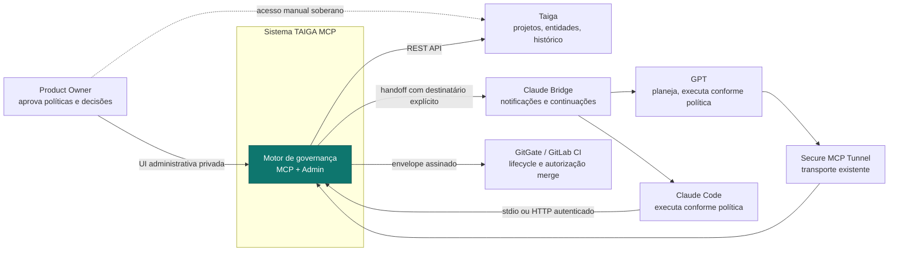
Limite de enforcement: a API original do Taiga não é alterada pelo MVP; acesso manual é separado e drift é detectável, não necessariamente evitável.

## C2 — Containers
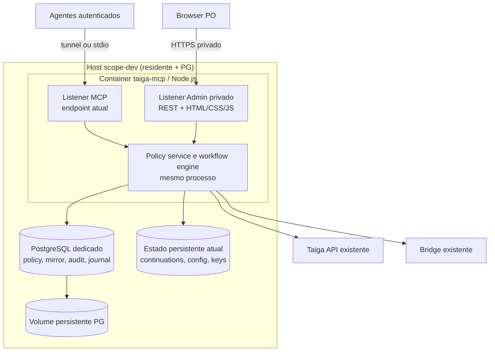
Se stdio ainda é iniciado por processo por ator, todos compartilham um único DB e política; não criar instância HTTP ou migrar túnel sem confirmar topologia.

## C3 — Componentes do container app
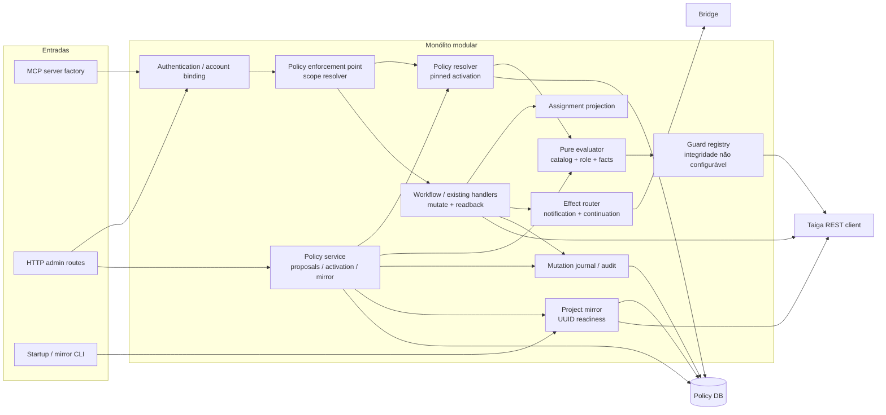
PDP (Policy Decision Point) e PEP (Policy Enforcement Point) são responsabilidades distintas, não serviços separados.

## C4 — Code level (interfaces propostas, nomes revisáveis)
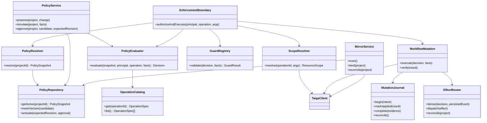
Implementar como módulos/funções TypeScript, não obrigatoriamente classes. C4 representa responsabilidades, não justificativa para abstrações artificiais.

## Use cases — atores e ações
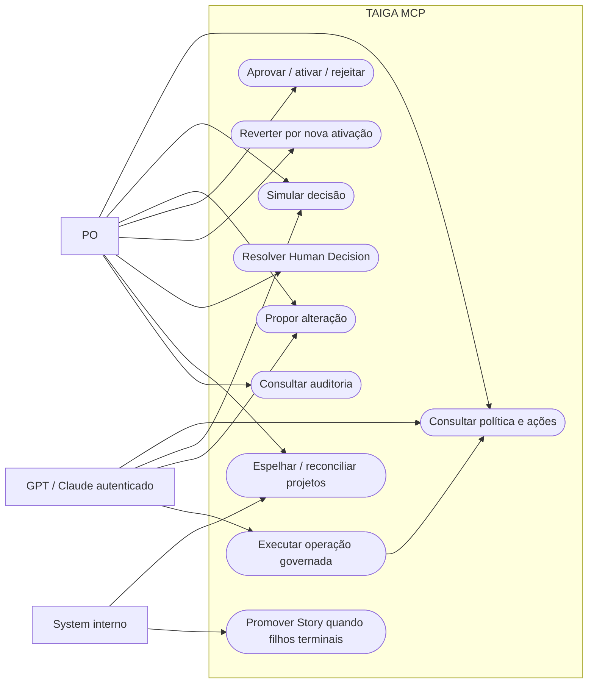
Executar operação não autoriza alterar política. System não pode ser impersonado. Leitura por agentes depende do escopo e política.

## ERD — dados de governança
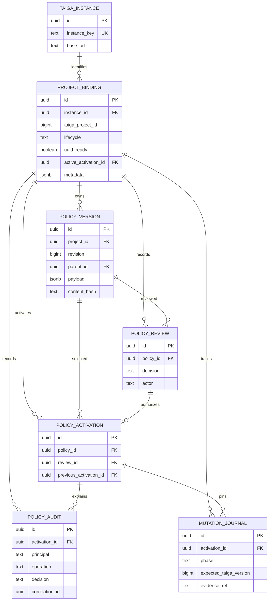
FKs compostas e checks adicionais definidos no plano. active_activation_id referencia exatamente uma ativação do próprio projeto. Não espelhar entidades de trabalho.

## Sequência A — criação de projeto
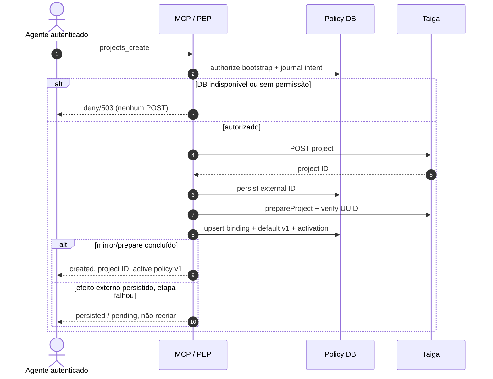

## Sequência B — proposta e aprovação
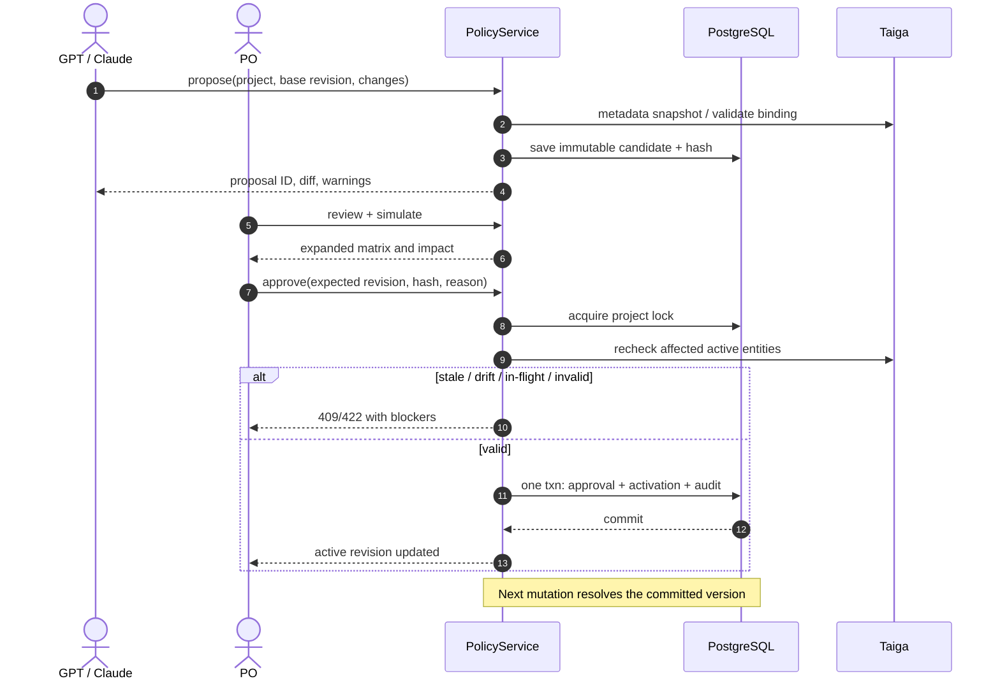

## Sequência C — autorização e transição
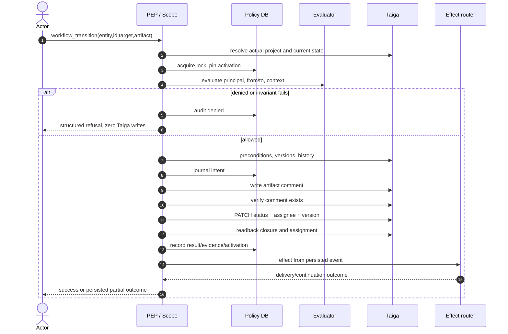
Ordem de liberação de locks e efeitos deve impedir ativação incompatível antes de registrar obrigação; notificações pós-persistência não desfazem status. Timeout não autoriza repetir mutação cegamente.

## Sequência D — GPT-only sem Claude
```mermaid
sequenceDiagram
  actor G as GPT
  participant M as MCP
  participant D as Active policy GPT-only
  participant T as Taiga
  actor P as PO
  G->>M: To Do -> In Progress + Blueprint
  M->>D: authorize GPT; owner GPT
  M->>T: persist state and evidence
  M-->>G: execution released to GPT
  Note over M,G: No Claude Bridge dispatch
  G->>G: implement and test
  G->>M: In Progress -> GPT Validation + Handoff
  M->>T: persist handoff / status
  G->>G: separate validation phase
  alt approval
    G->>M: GPT Validation -> Done + Approval
    M->>T: verify current evidence and Done
    M-->>G: result + signed merge authorization when required
  else human decision required
    G->>M: Human Decision request
    M->>T: persist Human Decision
    G-->>P: ask for decision
    P->>M: authenticated resolution
  end
```

## State machine — baseline Task, não DRAFT futuro
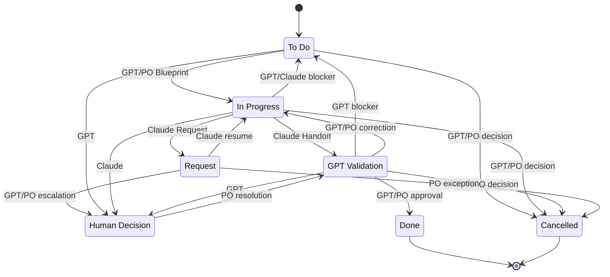
Diagrama simplifica caminhos PO override e wildcard Cancelled (incluindo casos que a fase 1 deve caracterizar); tabela completa/código são referência, não este desenho. Política GPT-only troca atores, preserva estados e artefatos; self-request pode ser negado explicitamente.

## State machine — versões de política
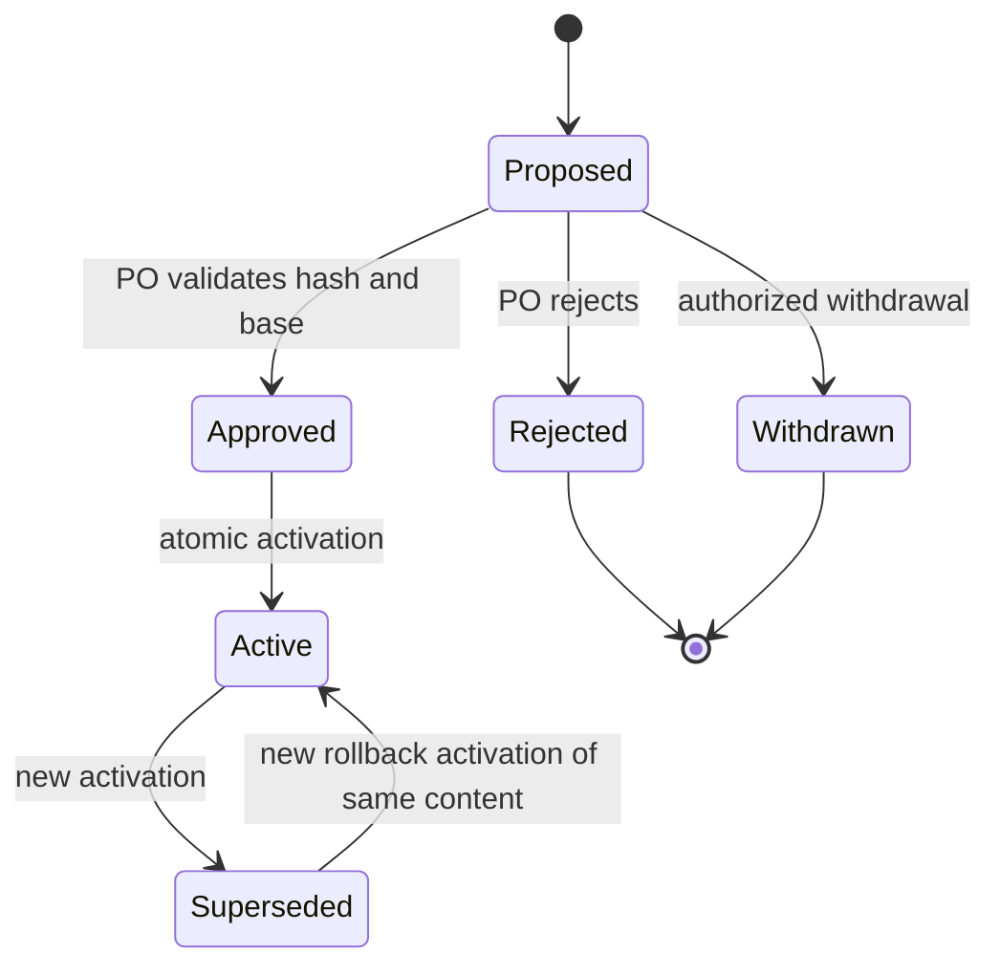
Approved/Active/Superseded são estados derivados de reviews e ativações append-only; não editar versão antiga.

## State machine — mirror e drift
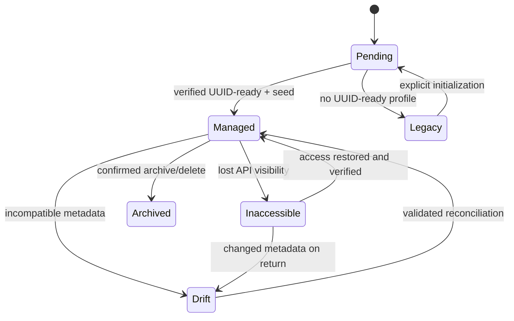

## Fluxo de reconciliação de efeitos externos
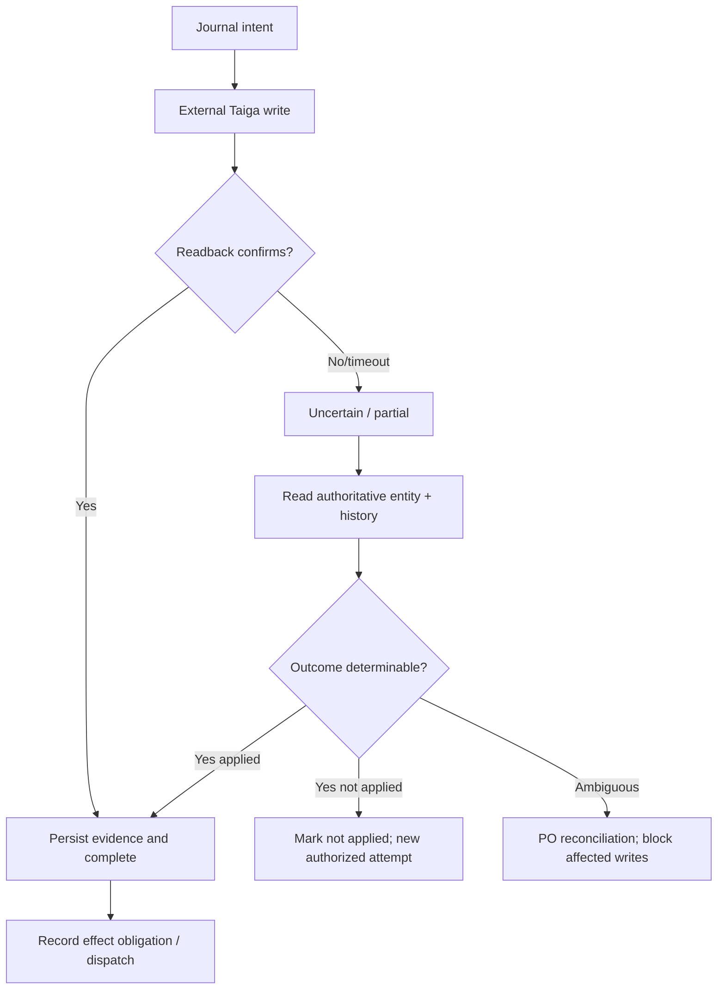

## UI — navegação e matriz foldable
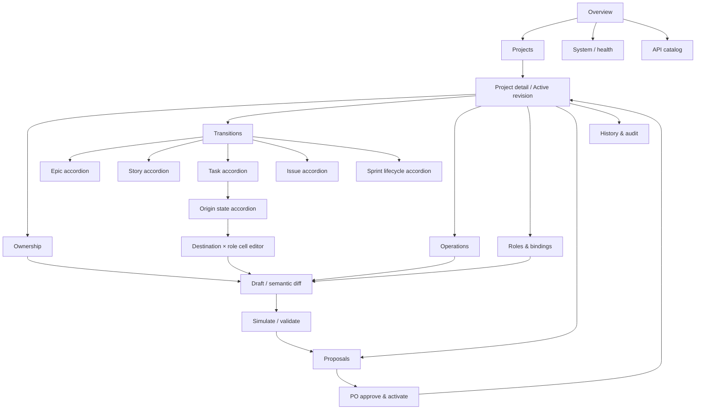

## Deployment e isolamento
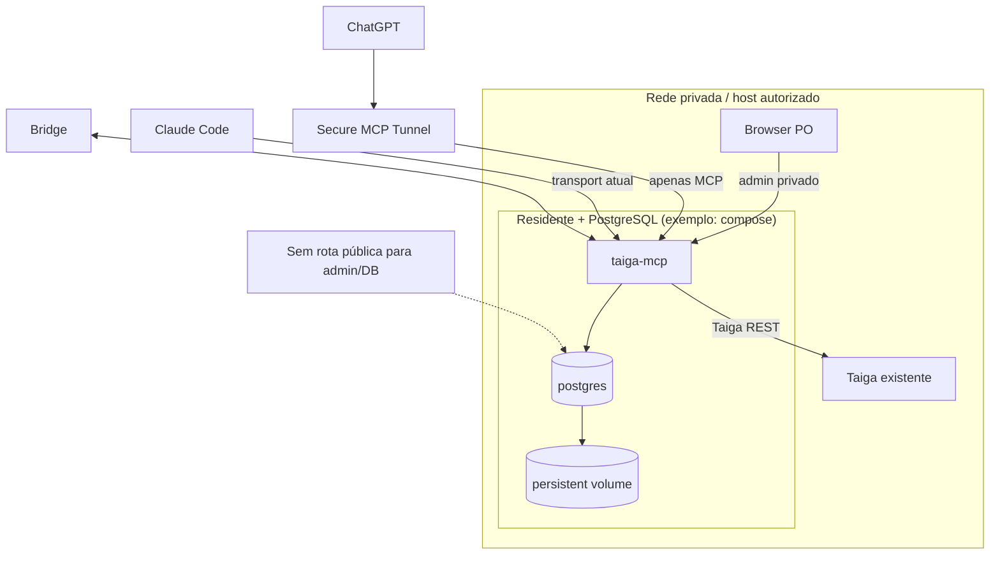

## Fases e gates (ordem obrigatória, v1.0)
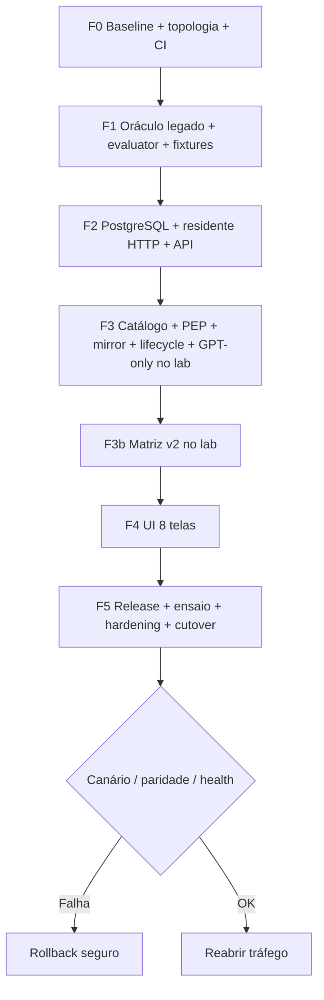

## Cutover / rollback
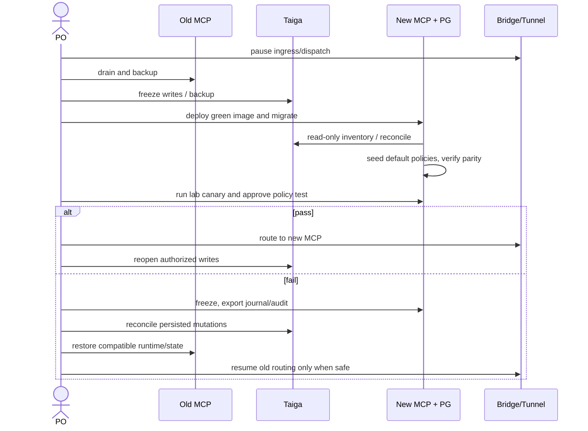
Não reverter snapshot do Taiga para apagar trabalho real. Downgrade após GPT-only ativo exige reconciliar policy/ownership e efeitos antes de retomar runtime antigo.

---

# Inventário preliminar de ferramentas MCP observadas

Gerado a partir das ferramentas disponíveis neste chat (não substitui tools/list autenticado do runtime, registro de handlers e cobertura REST na fase 0). Classificações são hipóteses de revisão, não autorizações. READ também exige escopo; EXPORT é sensível; ADMIN não significa que atualmente apenas PO pode executar. Cada linha deve receber operationId, scope resolver, autorização atual observada por ator/estado, campos, efeitos internos, guarda, teste e status de paridade antes de enforcement. Não derivar a autorização de uma regex em produção. Ações compostas e mutações indiretas precisam de classificação separada. As ferramentas de política novas não constam deste inventário.

Total observado: 257.

| Tool | Classe preliminar | Contrato anunciado |
|---|---|---|
| `taiga_projects_list` | READ | List projects. Optionally filter by member, is_featured, etc. |
| `taiga_projects_create` | MUTATION / REVIEW | Create a new project. |
| `taiga_project_apply_profile` | ADMIN / MUTATION | Check (dry_run=true, default) or fix (dry_run=false) a project against the canonical SCOPE profile: workflow statuses, colours, issue types, priorities, severities, epic statuses, the project default status of new Stories/Tasks/Issues/Epics (Ready, To Do, New, Proposed; existing cards never move), plus UUID readiness. Idempotent. The result is exactly the profile (no extras). A |
| `taiga_projects_get` | READ | Get a project by its ID. |
| `taiga_projects_get_by_slug` | READ | Get a project by its slug. |
| `taiga_projects_update` | MUTATION / REVIEW | Update a project (partial update). |
| `taiga_projects_delete` | MUTATION / REVIEW | Delete a project by its ID. |
| `taiga_projects_stats` | READ | Get project stats. |
| `taiga_projects_member_stats` | READ | Get project member stats. |
| `taiga_projects_issues_stats` | READ | Get project issues stats. |
| `taiga_projects_create_tag` | MUTATION / REVIEW | Create a tag in a project. |
| `taiga_projects_edit_tag` | MUTATION / REVIEW | Edit a tag in a project. |
| `taiga_projects_delete_tag` | MUTATION / REVIEW | Delete a tag from a project. |
| `taiga_projects_like` | MUTATION / REVIEW | Like a project. |
| `taiga_projects_unlike` | MUTATION / REVIEW | Unlike a project. |
| `taiga_projects_fans` | READ | List fans of a project. |
| `taiga_projects_watch` | MUTATION / REVIEW | Watch a project. |
| `taiga_projects_unwatch` | MUTATION / REVIEW | Stop watching a project. |
| `taiga_projects_watchers` | READ | List watchers of a project. |
| `taiga_epics_list` | READ | List epics. Filter by project. |
| `taiga_epics_create` | MUTATION / REVIEW | Create a new epic. |
| `taiga_epics_get` | READ | Get an epic by ID. |
| `taiga_epics_get_by_ref` | READ | Get an epic by ref and project. |
| `taiga_epics_update` | MUTATION / REVIEW | Update an epic (partial). In a governed project the status field cannot be used here: change status with taiga_workflow_transition and put the evidence in its `comment`. |
| `taiga_epics_delete` | MUTATION / REVIEW | Delete an epic. |
| `taiga_epics_bulk_create` | MUTATION / REVIEW | Bulk create epics. In a governed project `status_id` is refused: new items start in their default status and move only through taiga_workflow_transition. |
| `taiga_epics_filters_data` | READ | Get filters data for epics in a project. |
| `taiga_epics_related_userstories_list` | READ | List user stories related to an epic. |
| `taiga_epics_related_userstories_update_order` | MUTATION / REVIEW | Set the order of one Epic-Story relation (PATCH, order only). The relation has no id of its own; bulk order routes answer 405. |
| `taiga_epics_related_userstories_add` | MUTATION / REVIEW | Add a user story to an epic. |
| `taiga_epics_related_userstories_remove` | MUTATION / REVIEW | Remove a user story from an epic. |
| `taiga_epics_related_userstories_bulk_create` | MUTATION / REVIEW | Bulk add user stories to an epic. |
| `taiga_epics_upvote` | MUTATION / REVIEW | Upvote an epic. |
| `taiga_epics_downvote` | MUTATION / REVIEW | Remove vote from an epic. |
| `taiga_epics_voters` | READ | List voters of an epic. |
| `taiga_epics_watch` | MUTATION / REVIEW | Watch an epic. |
| `taiga_epics_unwatch` | MUTATION / REVIEW | Stop watching an epic. |
| `taiga_epics_watchers` | READ | List watchers of an epic. |
| `taiga_epics_attachments_list` | READ | List attachments of an epic. |
| `taiga_epics_attachment_get` | READ | Get a specific epic attachment. |
| `taiga_move` | MUTATION / REVIEW | Move a Task, Story or Sprint by intent (direction up/down, or before_id/after_id), never by raw order numbers. kind task = move inside the Task's own taskboard column (same status and Sprint) by taskboard_order, the only Task position (container_id = the Task's Sprint); story_in_sprint (container_id = Sprint); story_in_epic (container_id = Epic); sprint is a typed limitation (n |
| `taiga_userstories_list` | READ | List user stories with optional filters. |
| `taiga_userstories_create` | MUTATION / REVIEW | Create a new user story. |
| `taiga_userstories_get` | READ | Get a user story by ID. |
| `taiga_userstories_get_by_ref` | READ | Get a user story by ref and project. |
| `taiga_userstories_update` | MUTATION / REVIEW | Update a user story (partial). milestone only assigns a Sprint (a number); to return a Story to the Backlog use taiga_userstory_move_to_backlog. In a governed project the status field cannot be used here: change status with taiga_workflow_transition and put the evidence in its `comment`. |
| `taiga_userstory_move_to_backlog` | MUTATION / REVIEW | Return an existing User Story from its Sprint to the Backlog in one call (Sprint assignment is the milestone; a Story with no milestone is in the Backlog). Reads the Story, clears the milestone with its current version, rereads and fails closed unless milestone is null, and keeps a valid backlog_order (assigns the end of the Backlog only if it has none). Story id/ref/status/con |
| `taiga_userstories_delete` | MUTATION / REVIEW | Delete a user story. |
| `taiga_userstories_bulk_create` | MUTATION / REVIEW | Bulk create user stories. In a governed project `status_id` is refused: new items start in their default status and move only through taiga_workflow_transition. |
| `taiga_userstories_bulk_update_sprint_order` | MUTATION / REVIEW | Bulk update sprint order of user stories. |
| `taiga_userstories_filters_data` | READ | Get filters data for user stories in a project. |
| `taiga_userstories_upvote` | MUTATION / REVIEW | Upvote a user story. |
| `taiga_userstories_downvote` | MUTATION / REVIEW | Remove vote from a user story. |
| `taiga_userstories_voters` | READ | List voters of a user story. |
| `taiga_userstories_watch` | MUTATION / REVIEW | Watch a user story. |
| `taiga_userstories_unwatch` | MUTATION / REVIEW | Stop watching a user story. |
| `taiga_userstories_watchers` | READ | List watchers of a user story. |
| `taiga_userstories_attachments_list` | READ | List attachments of a user story. |
| `taiga_userstories_attachment_get` | READ | Get a specific user story attachment. |
| `taiga_tasks_list` | READ | List tasks with optional filters. |
| `taiga_tasks_create` | MUTATION / REVIEW | Create a new task. user_story is required: a Task without a User Story is refused. A task linked to a user_story always belongs to that story's Sprint; milestone is honoured only for standalone tasks (no user_story). |
| `taiga_tasks_get` | READ | Get a task by ID. |
| `taiga_tasks_get_by_ref` | READ | Get a task by ref and project. |
| `taiga_tasks_update` | MUTATION / REVIEW | Update a task (partial). In a governed project the status field cannot be used here: change status with taiga_workflow_transition and put the evidence in its `comment`. |
| `taiga_tasks_delete` | MUTATION / REVIEW | Delete a task. |
| `taiga_tasks_bulk_update_taskboard_order` | MUTATION / REVIEW | Bulk update the order of tasks in the taskboard (taskboard_order). In a governed project this low-level order path is refused: use taiga_move with kind "task". |
| `taiga_tasks_bulk_create` | MUTATION / REVIEW | Bulk create tasks. us_id is required: Tasks without a User Story are refused. In a governed project `status_id` is refused: new items start in their default status and move only through taiga_workflow_transition. |
| `taiga_tasks_filters_data` | READ | Get filters data for tasks in a project. |
| `taiga_tasks_upvote` | MUTATION / REVIEW | Upvote a task. |
| `taiga_tasks_downvote` | MUTATION / REVIEW | Remove vote from a task. |
| `taiga_tasks_voters` | READ | List voters of a task. |
| `taiga_tasks_watch` | MUTATION / REVIEW | Watch a task. |
| `taiga_tasks_unwatch` | MUTATION / REVIEW | Stop watching a task. |
| `taiga_tasks_watchers` | READ | List watchers of a task. |
| `taiga_tasks_attachments_list` | READ | List attachments of a task. |
| `taiga_tasks_attachment_get` | READ | Get a specific task attachment. |
| `taiga_issues_list` | READ | List issues with optional filters. |
| `taiga_issues_create` | MUTATION / REVIEW | Create a new issue. |
| `taiga_issues_get` | READ | Get an issue by ID. |
| `taiga_issues_get_by_ref` | READ | Get an issue by ref and project. |
| `taiga_issues_update` | MUTATION / REVIEW | Update an issue (partial). milestone only assigns a Sprint (a number); to return an Issue to the Backlog use taiga_issue_move_to_backlog. |
| `taiga_issue_move_to_backlog` | MUTATION / REVIEW | Return an existing Issue from its Sprint to the Backlog in one call (Sprint assignment is the milestone; an Issue with no milestone is not in a Sprint). Reads the Issue, clears the milestone with its current version, rereads and fails closed unless milestone is null and id/ref/status/subject are unchanged. Everything else on the Issue is untouched. An Issue already without a Sp |
| `taiga_issues_delete` | MUTATION / REVIEW | Delete an issue. |
| `taiga_issues_promote_to_userstory` | MUTATION / REVIEW | Promote an issue to a user story in a project (Taiga promote action). Returns the generated story, which keeps generated_from_issue/origin_issue pointing at the issue. |
| `taiga_issues_bulk_create` | MUTATION / REVIEW | Bulk create issues. |
| `taiga_issues_filters_data` | READ | Get filters data for issues in a project. |
| `taiga_issues_upvote` | MUTATION / REVIEW | Upvote an issue. |
| `taiga_issues_downvote` | MUTATION / REVIEW | Remove vote from an issue. |
| `taiga_issues_voters` | READ | List voters of an issue. |
| `taiga_issues_watch` | MUTATION / REVIEW | Watch an issue. |
| `taiga_issues_unwatch` | MUTATION / REVIEW | Stop watching an issue. |
| `taiga_issues_watchers` | READ | List watchers of an issue. |
| `taiga_issues_attachments_list` | READ | List attachments of an issue. |
| `taiga_issues_attachment_get` | READ | Get a specific issue attachment. |
| `taiga_milestones_list` | READ | List milestones/sprints. Filter by project. |
| `taiga_milestones_create` | MUTATION / REVIEW | Create a new milestone/sprint. |
| `taiga_milestones_get` | READ | Get a milestone/sprint by ID. |
| `taiga_milestones_update` | MUTATION / REVIEW | Update a milestone/sprint (partial). |
| `taiga_milestones_prepare_close` | MUTATION / REVIEW | Prepare a Sprint close (GPT or PO only). The Sprint STAYS OPEN: it signs the sprint-done merge authorization, stores it as the durable merge-ready record and emits the SPRINT_CLOSED merge pointer (status 'Merge ready; Sprint still open'). Nothing is final until taiga_milestones_confirm_merge and taiga_milestones_close. merge_context carries the git coordinates only. |
| `taiga_milestones_confirm_merge` | MUTATION / REVIEW | Record the GitGate Sprint completion receipt (GPT, Claude or PO). The receipt is produced and Ed25519-signed by GitGate with its own key and verified here with the configured GitGate public key; it must be bound to the Sprint's signed merge-ready authorization. Nothing the caller asserts outside the signed receipt is trusted. A receipt with a branch not yet removed is stored bu |
| `taiga_milestones_close` | MUTATION / REVIEW | Close a Sprint (GPT or PO only), the terminal step: refused unless the merge was confirmed for the Sprint's prepared authorization (taiga_milestones_prepare_close, taiga_milestones_confirm_merge). Persists closed=true and re-reads it; idempotent: an already-closed Sprint succeeds only if its stored signed authorization and GitGate receipt still verify, and an unprovable re-read |
| `taiga_milestones_delete` | MUTATION / REVIEW | Delete a milestone/sprint. |
| `taiga_milestones_stats` | READ | Get milestone/sprint stats (burndown, etc.). |
| `taiga_milestones_watch` | MUTATION / REVIEW | Watch a milestone. |
| `taiga_milestones_unwatch` | MUTATION / REVIEW | Stop watching a milestone. |
| `taiga_milestones_watchers` | READ | List watchers of a milestone. |
| `taiga_wiki_list` | READ | List wiki pages. Filter by project. |
| `taiga_wiki_create` | MUTATION / REVIEW | Create a wiki page. |
| `taiga_wiki_get` | READ | Get a wiki page by ID. |
| `taiga_wiki_get_by_slug` | READ | Get a wiki page by slug and project. |
| `taiga_wiki_update` | MUTATION / REVIEW | Update a wiki page (partial). |
| `taiga_wiki_delete` | MUTATION / REVIEW | Delete a wiki page. |
| `taiga_wiki_watch` | MUTATION / REVIEW | Watch a wiki page. |
| `taiga_wiki_unwatch` | MUTATION / REVIEW | Stop watching a wiki page. |
| `taiga_wiki_watchers` | READ | List watchers of a wiki page. |
| `taiga_wiki_attachments_list` | READ | List attachments of a wiki page. |
| `taiga_wiki_links_list` | READ | List wiki links. Filter by project. |
| `taiga_wiki_links_create` | MUTATION / REVIEW | Create a wiki link. |
| `taiga_wiki_links_get` | READ | Get a wiki link by ID. |
| `taiga_wiki_links_update` | MUTATION / REVIEW | Update a wiki link. |
| `taiga_wiki_links_delete` | MUTATION / REVIEW | Delete a wiki link. |
| `taiga_memberships_list` | READ | List memberships. Filter by project or role. |
| `taiga_memberships_create` | ADMIN / MUTATION | Create a membership (invite user to project). |
| `taiga_memberships_get` | READ | Get a membership by ID. |
| `taiga_memberships_update` | ADMIN / MUTATION | Update a membership (change role). |
| `taiga_memberships_delete` | ADMIN / MUTATION | Delete a membership (remove user from project). |
| `taiga_memberships_bulk_create` | ADMIN / MUTATION | Bulk invite members to a project. |
| `taiga_roles_list` | READ | List roles. Filter by project. |
| `taiga_roles_create` | ADMIN / MUTATION | Create a new role. |
| `taiga_roles_get` | READ | Get a role by ID. |
| `taiga_roles_update` | ADMIN / MUTATION | Update a role (partial). |
| `taiga_roles_delete` | ADMIN / MUTATION | Delete a role. |
| `taiga_users_list` | READ | List users. Filter by project. |
| `taiga_users_get` | READ | Get a user by ID. |
| `taiga_users_me` | READ | Get current authenticated user info. |
| `taiga_users_stats` | READ | Get user stats. |
| `taiga_users_liked` | READ | List projects liked by a user. |
| `taiga_users_voted` | READ | List items voted by a user. |
| `taiga_users_watched` | READ | List items watched by a user. |
| `taiga_users_contacts` | READ | List contacts of a user. |
| `taiga_userstory_statuses_list` | READ | List userstory statuses. Filter by project. |
| `taiga_userstory_statuses_create` | ADMIN / MUTATION | Create a new userstory statuses. |
| `taiga_userstory_statuses_get` | READ | Get a userstory statuses by ID. |
| `taiga_userstory_statuses_update` | ADMIN / MUTATION | Update a userstory statuses (partial). |
| `taiga_userstory_statuses_delete` | ADMIN / MUTATION | Delete a userstory statuses. |
| `taiga_userstory_statuses_bulk_update_order` | ADMIN / MUTATION | Bulk update order of userstory statuses. |
| `taiga_task_statuses_list` | READ | List task statuses. Filter by project. |
| `taiga_task_statuses_create` | ADMIN / MUTATION | Create a new task statuses. |
| `taiga_task_statuses_get` | READ | Get a task statuses by ID. |
| `taiga_task_statuses_update` | ADMIN / MUTATION | Update a task statuses (partial). |
| `taiga_task_statuses_delete` | ADMIN / MUTATION | Delete a task statuses. |
| `taiga_task_statuses_bulk_update_order` | ADMIN / MUTATION | Bulk update order of task statuses. |
| `taiga_issue_statuses_list` | READ | List issue statuses. Filter by project. |
| `taiga_issue_statuses_create` | ADMIN / MUTATION | Create a new issue statuses. |
| `taiga_issue_statuses_get` | READ | Get a issue statuses by ID. |
| `taiga_issue_statuses_update` | ADMIN / MUTATION | Update a issue statuses (partial). |
| `taiga_issue_statuses_delete` | ADMIN / MUTATION | Delete a issue statuses. |
| `taiga_issue_statuses_bulk_update_order` | ADMIN / MUTATION | Bulk update order of issue statuses. |
| `taiga_issue_types_list` | READ | List issue types. Filter by project. |
| `taiga_issue_types_create` | ADMIN / MUTATION | Create a new issue types. |
| `taiga_issue_types_get` | READ | Get a issue types by ID. |
| `taiga_issue_types_update` | ADMIN / MUTATION | Update a issue types (partial). |
| `taiga_issue_types_delete` | ADMIN / MUTATION | Delete a issue types. |
| `taiga_issue_types_bulk_update_order` | ADMIN / MUTATION | Bulk update order of issue types. |
| `taiga_priorities_list` | READ | List priorities. Filter by project. |
| `taiga_priorities_create` | ADMIN / MUTATION | Create a new priorities. |
| `taiga_priorities_get` | READ | Get a priorities by ID. |
| `taiga_priorities_update` | ADMIN / MUTATION | Update a priorities (partial). |
| `taiga_priorities_delete` | ADMIN / MUTATION | Delete a priorities. |
| `taiga_priorities_bulk_update_order` | ADMIN / MUTATION | Bulk update order of priorities. |
| `taiga_severities_list` | READ | List severities. Filter by project. |
| `taiga_severities_create` | ADMIN / MUTATION | Create a new severities. |
| `taiga_severities_get` | READ | Get a severities by ID. |
| `taiga_severities_update` | ADMIN / MUTATION | Update a severities (partial). |
| `taiga_severities_delete` | ADMIN / MUTATION | Delete a severities. |
| `taiga_severities_bulk_update_order` | ADMIN / MUTATION | Bulk update order of severities. |
| `taiga_points_list` | READ | List points. Filter by project. |
| `taiga_points_create` | ADMIN / MUTATION | Create a new points. |
| `taiga_points_get` | READ | Get a points by ID. |
| `taiga_points_update` | ADMIN / MUTATION | Update a points (partial). |
| `taiga_points_delete` | ADMIN / MUTATION | Delete a points. |
| `taiga_points_bulk_update_order` | ADMIN / MUTATION | Bulk update order of points. |
| `taiga_epic_custom_attributes_list` | READ | List custom attribute definitions for epic. Filter by project. |
| `taiga_epic_custom_attributes_create` | ADMIN / MUTATION | Create a custom attribute definition for epic. |
| `taiga_epic_custom_attributes_get` | READ | Get a custom attribute definition for epic. |
| `taiga_epic_custom_attributes_update` | ADMIN / MUTATION | Update a custom attribute definition for epic. |
| `taiga_epic_custom_attributes_delete` | ADMIN / MUTATION | Delete a custom attribute definition for epic. |
| `taiga_epic_custom_attributes_values_get` | READ | Get custom attribute values for a specific epic. |
| `taiga_epic_custom_attributes_values_update` | MUTATION / REVIEW | Update custom attribute values for a specific epic. |
| `taiga_userstory_custom_attributes_list` | READ | List custom attribute definitions for userstory. Filter by project. |
| `taiga_userstory_custom_attributes_create` | ADMIN / MUTATION | Create a custom attribute definition for userstory. |
| `taiga_userstory_custom_attributes_get` | READ | Get a custom attribute definition for userstory. |
| `taiga_userstory_custom_attributes_update` | ADMIN / MUTATION | Update a custom attribute definition for userstory. |
| `taiga_userstory_custom_attributes_delete` | ADMIN / MUTATION | Delete a custom attribute definition for userstory. |
| `taiga_userstory_custom_attributes_values_get` | READ | Get custom attribute values for a specific userstory. |
| `taiga_userstory_custom_attributes_values_update` | MUTATION / REVIEW | Update custom attribute values for a specific userstory. |
| `taiga_task_custom_attributes_list` | READ | List custom attribute definitions for task. Filter by project. |
| `taiga_task_custom_attributes_create` | ADMIN / MUTATION | Create a custom attribute definition for task. |
| `taiga_task_custom_attributes_get` | READ | Get a custom attribute definition for task. |
| `taiga_task_custom_attributes_update` | ADMIN / MUTATION | Update a custom attribute definition for task. |
| `taiga_task_custom_attributes_delete` | ADMIN / MUTATION | Delete a custom attribute definition for task. |
| `taiga_task_custom_attributes_values_get` | READ | Get custom attribute values for a specific task. |
| `taiga_task_custom_attributes_values_update` | MUTATION / REVIEW | Update custom attribute values for a specific task. |
| `taiga_issue_custom_attributes_list` | READ | List custom attribute definitions for issue. Filter by project. |
| `taiga_issue_custom_attributes_create` | ADMIN / MUTATION | Create a custom attribute definition for issue. |
| `taiga_issue_custom_attributes_get` | READ | Get a custom attribute definition for issue. |
| `taiga_issue_custom_attributes_update` | ADMIN / MUTATION | Update a custom attribute definition for issue. |
| `taiga_issue_custom_attributes_delete` | ADMIN / MUTATION | Delete a custom attribute definition for issue. |
| `taiga_issue_custom_attributes_values_get` | READ | Get custom attribute values for a specific issue. |
| `taiga_issue_custom_attributes_values_update` | MUTATION / REVIEW | Update custom attribute values for a specific issue. |
| `taiga_uuid_initialize_project` | ADMIN / MUTATION | Make a project UUID-ready AND bring it to the canonical SCOPE profile (same as taiga_project_apply_profile; a blocked profile writes nothing). For Task, User Story, Epic and Issue, define the `UUID` custom attribute where it is missing and give every entity without one a UUIDv7 (MCP-generated). Valid UUIDv7 values are never changed; invalid existing values are only reported, ne |
| `taiga_uuid_backfill` | ADMIN / MUTATION | DEPRECATED UUID-only variant of taiga_uuid_initialize_project (does NOT apply the profile). `entities` selects a subset; a partial result is never `uuid_ready` for the project (`partial: true`, `selected_kinds_ready`). Use taiga_uuid_initialize_project. |
| `taiga_uuid_resolve` | READ | Resolve a persistent entity UUID (UUIDv7) to its Task, User Story, Epic or Issue: type, project, internal id, human ref and subject. The UUID is the authoritative identity; #ref is only a convenience. Zero matches = not_found; more than one = duplicate (closed failure, all matches listed, none chosen). Taiga cannot filter by custom attribute, so this scans the given project (or |
| `taiga_userstory_history` | READ | Get change history for a userstory. |
| `taiga_userstory_comment_create` | MUTATION / REVIEW | Add a comment to a userstory. Comment is posted via the history endpoint. |
| `taiga_userstory_comment_delete` | MUTATION / REVIEW | Delete a comment from a userstory. |
| `taiga_task_history` | READ | Get change history for a task. |
| `taiga_task_comment_create` | MUTATION / REVIEW | Add a comment to a task. Comment is posted via the history endpoint. In a Task of a project with the strict workflow vocabulary, free comments are disabled while governance is ON: ownership evidence is written by taiga_workflow_transition artifacts and taiga_workflow_request_* tools. Only the authenticated PO may add a maintenance comment or delete one. |
| `taiga_task_comment_delete` | MUTATION / REVIEW | Delete a comment from a task. In a Task of a project with the strict workflow vocabulary, free comments are disabled while governance is ON: ownership evidence is written by taiga_workflow_transition artifacts and taiga_workflow_request_* tools. Only the authenticated PO may add a maintenance comment or delete one. |
| `taiga_issue_history` | READ | Get change history for a issue. |
| `taiga_issue_comment_create` | MUTATION / REVIEW | Add a comment to a issue. Comment is posted via the history endpoint. |
| `taiga_issue_comment_delete` | MUTATION / REVIEW | Delete a comment from a issue. |
| `taiga_wiki_history` | READ | Get change history for a wiki. |
| `taiga_wiki_comment_create` | MUTATION / REVIEW | Add a comment to a wiki. Comment is posted via the history endpoint. |
| `taiga_wiki_comment_delete` | MUTATION / REVIEW | Delete a comment from a wiki. |
| `taiga_search` | READ | Global search across a project (user stories, tasks, issues, wiki pages). |
| `taiga_timeline_user` | READ | Get timeline for a user. |
| `taiga_timeline_profile` | READ | Get timeline for a user profile (public events only). |
| `taiga_timeline_project` | READ | Get timeline for a project. |
| `taiga_resolver_project` | READ | Resolve a project slug to its ID. |
| `taiga_resolver_userstory` | READ | Resolve a user story ref to its ID. |
| `taiga_resolver_issue` | READ | Resolve an issue ref to its ID. |
| `taiga_resolver_task` | READ | Resolve a task ref to its ID. |
| `taiga_resolver_milestone` | READ | Resolve a milestone slug to its ID. |
| `taiga_resolver_wiki` | READ | Resolve a wiki page slug to its ID. |
| `taiga_resolver_epic` | READ | Resolve an epic ref to its ID. |
| `taiga_webhooks_list` | READ | List webhooks. Filter by project. |
| `taiga_webhooks_create` | ADMIN / MUTATION | Create a new webhook. |
| `taiga_webhooks_get` | READ | Get a webhook by ID. |
| `taiga_webhooks_update` | ADMIN / MUTATION | Update a webhook (partial). |
| `taiga_webhooks_delete` | ADMIN / MUTATION | Delete a webhook. |
| `taiga_webhooks_test` | ADMIN / MUTATION | Test a webhook by sending a test payload. |
| `taiga_webhooklogs_list` | READ | List webhook logs. Filter by webhook. |
| `taiga_webhooklogs_get` | READ | Get a webhook log entry by ID. |
| `taiga_webhooklogs_resend` | ADMIN / MUTATION | Resend a failed webhook delivery. |
| `taiga_project_export` | EXPORT (data access) | Export a project (returns export data or starts async export). |
| `taiga_project_import` | ADMIN / MUTATION | Import a project from a JSON dump. |
| `taiga_governance_status` | READ | Read-only: whether workflow governance is ON for this whole MCP (ON by default). It is changed only by the local admin CLI, never through the MCP. |
| `taiga_workflow_transition` | MUTATION / REVIEW | Change a Task, User Story or Epic status. Generic path: `comment` is required and is the place for the evidence: it is the card's one comment for this move, so do NOT post a separate comment first. It is posted verbatim (record what was done and how; when moving backwards, say exactly why it came back) and proven persisted in history before the status changes. STRICT WORKFLOW P |
| `taiga_workflow_template` | READ | Read-only: the contract of a workflow artifact template. The Markdown file is the only source of truth. Without `name` lists the templates and their versions. With `name` the HIGHEST SemVer version is used unless `version` selects a historical one (existing artifacts are read against the version they declare). `format`: raw (default) = the file content plus name, version and so |
| `taiga_task_workflow_state` | READ | Read-only derived view of a Task's workflow: current status and owner role, the current Blueprint and validation round, open Workflow Requests (who must answer each, and whether any is blocking), and what the caller may and may not do next, with reasons. A read model over Taiga history, not a second state owner: the owner is decided only by the status. |
| `taiga_workflow_request_create` | MUTATION / REVIEW | Create a structured Workflow Request on a Task, from the calling actor to another actor. Use a Workflow Request when the current owner needs ONE bounded answer from someone else (an analysis, a clarification of the contract, a piece of evidence, or something the asker cannot do) without the Task changing status or owner. It does NOT replace an Implementation Blueprint, Executio |
| `taiga_workflow_request_answer` | MUTATION / REVIEW | Answer an open Workflow Request on a Task. Only the request's addressee (to_actor) can answer; nobody can answer on their behalf, not even another actor. resolved=true marks the request resolved; resolved=false records a partial answer and keeps it open. Use a Workflow Request when the current owner needs ONE bounded answer from someone else (an analysis, a clarification of the |
| `taiga_human_decision_resolve` | MUTATION / REVIEW | Record, as a governed Human Decision Resolution, an explicit decision the PO took OUTSIDE Taiga for a Task that is in Human Decision. It is NOT a status transition: the Task stays in Human Decision. Only GPT or the PO can call it (the author records the decision, the PO is the decision authority). The destination is ALWAYS GPT Validation / gpt: a resolved Human Decision never r |
| `taiga_continuations_pending` | READ | List the durable workflow continuations still open (pending or delivered, not handled) for the caller. GPT and Claude see only their own; the PO may pass `actor`. Optional `project` scopes it. Before listing it rebuilds any missing continuation from the authoritative Taiga state of open Sprints (same ids as normal emission, never touching existing or handled ones), so a failed  |
| `taiga_continuation_ack` | MUTATION / REVIEW | Acknowledge a continuation by id. ack=delivered records only that the consumer saw it (it stays open); ack=handled records that the consumer re-read Taiga and completed or deliberately resolved the authorized next step (it closes). Only the addressee (or the PO) can acknowledge; handled also writes one auditable, non-authoritative "Continuation Handled" marker on the card so a  |
| `taiga_assignees_backfill` | ADMIN / MUTATION | Repair Assigned on the open Tasks and Stories of ONE Sprint. The target owner is derived only from each card's current status through the canonical resolver (never from watchers, creator or the current assignee); only assigned_to is written, so status, order, history and watchers are untouched. Done/Cancelled and ownerless statuses are skipped. Idempotent. dry_run (default true |

## Gate
Comparar catálogo final com todas as ferramentas efetivamente registradas, por identidade e transporte, incluindo aliases e efeitos compostos. Nenhuma ausência ou classificação implícita permitida. Gerar células de autorização por role/estado/ação a partir dos status reais. Não inventar ferramentas de Epic status ou anexos se não expostas; mapear operações REST subjacentes efetivamente acionáveis e registrar indisponível onde necessário.
